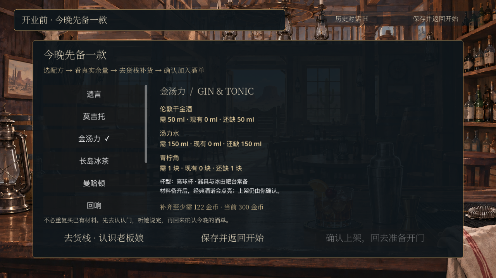
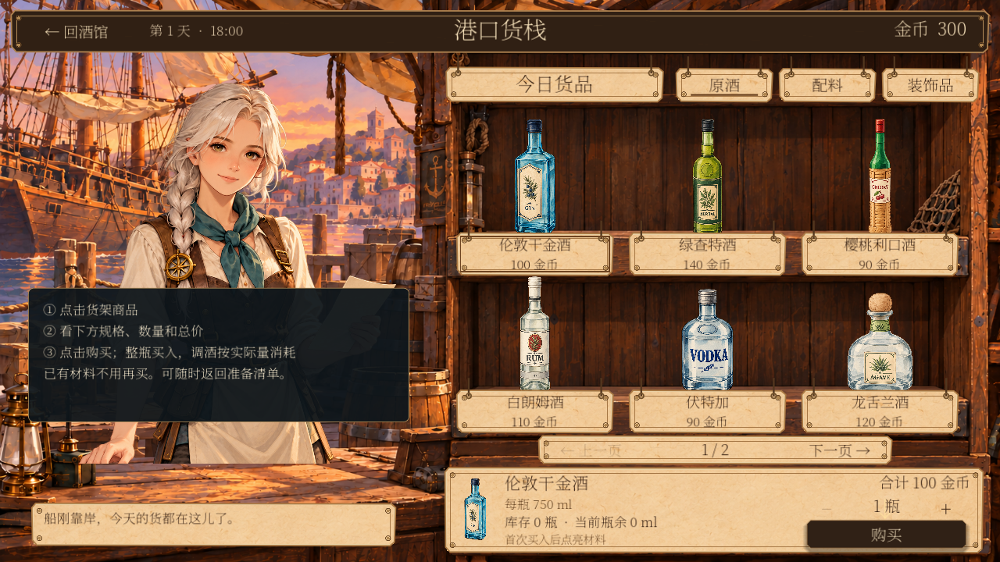
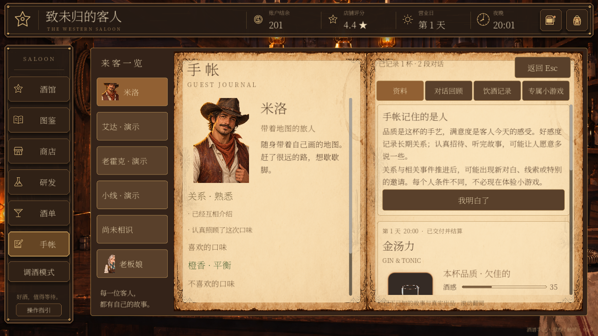
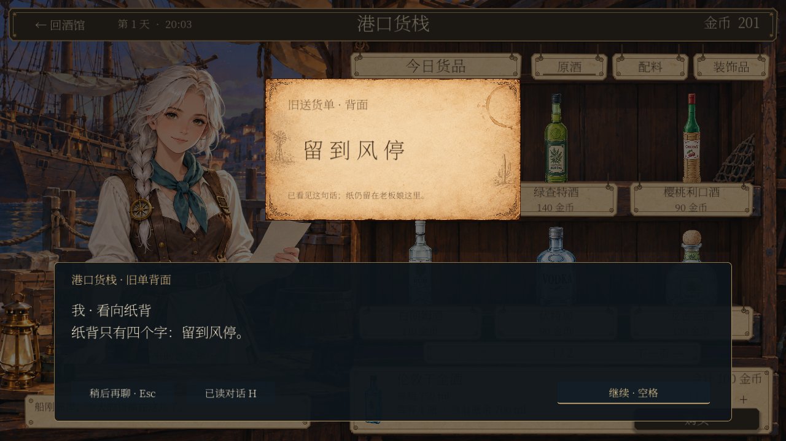

# 第六部分实现说明与验收

日期：2026-10-17。版本性质：可试玩首版，关系数值仍是可调整配置。

## 1. 这一版完成了什么

已经把调酒教学之后的开业衔接接入 Godot。玩家从“今天这杯回响”走到第一次开门，过程中认识货栈老板娘、使用真实库存与购买系统，并在正式招待后了解关系和线索机制。

实际顺序：

**回响成品反馈 → 投递员送来账册 → 签收、给赶路的人一杯水 → 选今晚备的酒 → 货栈初次见面与采购 → 听说旧送货单 → 确认上架 → 翻营业牌 → 米洛首次正式招待 → 手帐关系引导 → 再访老板娘、看到旧单背面。**

前半段有 26 个稳定剧情节点。商店老板娘另外有四组对话，分别承担初识、埋线、正式招待后的再访、展示证据四个功能。教程不要求进入小游戏。

## 2. 如何体验

- 新游戏完成或跳过调酒练习后，进入这段开业准备。跳过练习时对白会调整，不假装玩家实际做过那杯酒。
- 已停在教程结尾的存档，从开始界面继续，会进入新衔接场景。
- 已经正式开业的旧存档保持原进度，不会重新强制做开业准备。可以在商店认识老板娘，逐步接入新对话。
- 想只看演出，可以使用开始界面已有的序章回看。回看中的备料是说明预览，不发生真实采购，不改变正式酒单、关系和经营进度。
- 正式流程中可保存返回开始界面；再次继续会恢复准备进度和老板娘对话位置。

完整的真实采购与开业闭环需要新游戏流程。不要为了看演出直接重置已有存档；回看适合预览对白和衔接。

## 3. 剧情与画面

### 回响的收束

成品预览读取教学实际单杯结果。对白按评价区分较好的成品、明显偏甜、明显偏酸及其他结果；不强制称赞每一杯都完美。跳过练习则用相应替代对白。

这部分继续使用“回响 / Echo World”、午夜蓝草本酒和原有液体表现，没有替换为蓝橙方案，也没有改经典 Last Word 配方。

### 投递员与开门

投递员送来账册和旧酒单，玩家签收，再给赶路的人留一杯水。签收与开门都保存事件状态；重复操作不重复产生奖励。投递员只是开业衔接角色，没有新增完整常驻客人系统。

当前演出复用酒馆、门廊和纸张美术，加入账册、签收单、水杯、营业牌等画面元素。关键目标有箭头和呼吸亮度提示。继续支持鼠标点击与空格；历史对话由独立入口或 H 打开，历史窗口内的空格不会推进背后的剧情。

营业牌可以点击、拖动或按空格操作。当前是轻量道具切换演出，还不是完整手部动作或重新绘制的连续 CG。

### 老板娘与线索

保留现有白发老板娘立绘和港口商店。没有擅自给她定正式姓名。她的介绍围绕实际备货展开：“今晚想做什么，就先备什么。”

首次采购回来，只听说她留着一张已经结清的旧送货单。此时手帐只能记录“听说有这张单”，不会提前显示纸背。

至少完成一次正式招待后，可以再回来聊第一晚的经历。完成这组对话，并达到本版配置的关系门槛后，开放旧单对话。玩家真正看到纸背时，才记录“留到风停”这句证据。纸仍在老板娘这里，不伪装成已经领取的背包道具。

对话配合既有场景音乐；签收、敲门、杯子等节点使用已有纸张、木质和碰杯音效。本次没有制作全新配音或原创音乐。

## 4. 商店教学怎样与真实经营接上

备料页从现有酒谱、商品和库存计算需求，逐项显示需要量、现有量、缺少量与补货金额。购买仍走现有商店交易，不建立第二套钱包或库存。

玩家确认上架前，需要实际备齐一款酒，并完成老板娘的初识与埋线对话。已有库存会抵扣需求；不会因为进入教程再买一次。开门前再次检查当前酒单至少有一款可制作的酒。

首次流程的一个重要实际约束：当前新游戏资金为 300，空仓备齐回响至少需 394；空仓备齐金汤力需 122。因此没有强制第一晚仍售卖回响，也没有偷偷加钱。界面允许选择成本更低的酒，先跑通营业。

以上金额来自本次验收时的商品配置，后台会按实时价格和包装量重新计算，不能视为永久平衡数值。

经典酒谱的材料解锁与加入营业酒单仍分开：材料齐全可以点亮酒谱，真正上架必须由玩家确认。上架不删除玩家已有酒单。

教学期间暂停营业计时；完成开门后回到既有营业系统，首次正式客人仍是米洛。

器具、杯子与冰沿用当前项目的吧台常备规则。本次没有额外实现“冰块也需商店补货”的库存机制。

## 5. 品质、满意度、关系如何区分

| 层次 | 含义 | 当前来源与影响 |
| --- | --- | --- |
| 成品品质 | 这杯酒在配方和制作方面表现怎样 | 原有单杯评价，不因本次改动重算 |
| 当次满意度 | 客人这次是否喜欢这杯酒 | 原有招待结算，继续影响本次结果 |
| 长期关系 | 与这个人已经共同经历了什么 | 新增事件账本，显示阶段与变化理由 |
| 剧情线索 | 实际听到或看到哪些信息 | 按对话节点记录，区分听说与证据 |

正式招待后，首页出现手帐提示。玩家打开手帐能看到上述区别，而不是马上被带入小游戏。手帐新增老板娘资料、已读对话和已知线索。已有客人的饮酒记录、历史对白、奖励和小游戏入口继续保留。

### 当前可调数值

配置文件为 `data/relationships.json`，标记为 `playtest`。

| 事件或阶段 | 当前配置 |
| --- | --- |
| 相识 | 记录身份，0 分 |
| 完成一个人物故事章节 | 一次性 +1 |
| 正式招待且满意度至少 70 | 每次独立来访一次性 +2 |
| 与老板娘聊完第一晚的经历 | 一次性 +2 |
| 初识／熟悉／信任／深交 | 0／2／8／18 起 |
| 旧单对话 | 完成再访对话且老板娘关系至少 2 |

购买商品、教学练习、自由调酒和研发不会直接换取好感度。一次招待即使不理想，也可以满足“已经正式接待过客人”的再访经历条件，不会因为首杯不完美卡住故事。

事件保存发生时的分值及规则版本。以后调整配置不会自动改写旧事件的历史分值；如要全量重新平衡旧存档，需要另做明确的数据迁移。

现有小游戏仍读取原来的章节和满意招待条件。米洛第二轮、老霍克第三轮的节奏不被新关系阶段替换；本次也没有新增第二个角色小游戏。

## 6. 数据与存档对齐

| 文件或服务 | 职责 |
| --- | --- |
| `data/opening/departure.json` | 开业衔接节点、对白、背景、音效提示、道具与动作 |
| `scripts/opening_departure.gd` | 场景呈现、键鼠交互、备料及商店流程衔接 |
| `scripts/opening_preparation.gd` | 从真实库存计算缺口，检查可制作性，调用酒单上架 |
| `scripts/opening_flow.gd` | 开篇状态、当前节点、已读对白、签收与开门状态 |
| `data/relationships.json` | 关系试玩参数和老板娘四组对白 |
| `scripts/relationship_service.gd` | 关系事件、对话游标、线索标记、手帐引导状态 |
| `scripts/merchant_conversation.gd` | 老板娘对白、历史窗口、旧单纸张展示 |
| 既有库存／钱包／酒单／招待服务 | 继续负责各自真实数据与结算 |

关系存档独立保存在当前游戏会话存档旁的 `.relationships` 文件中。写入采用临时文件落盘再替换，失败不推进内存中的对话游标；损坏文件会阻止覆盖，而不是静默清空。

关系事件使用稳定 ID，例如人物章节 ID、招待来访 ID。重复点击、重载或从两条兼容结算路径读到同一次来访时，不重复加分。已读对白按主题与行号去重；玩家没看到的后文不会提前进入手帐。

原有经营记录是关系推导依据。旧存档加载时，可从已完成故事和已结算招待补建关系事件；不会给旧玩家重置故事、补扣原料或重新收款。

正式“重新开始”流程会同时处理关系数据，沿用现有备份与重置机制。回看使用隔离状态，不改写这份正式关系记录。

## 7. 验收记录

Godot 4.7.2，本机运行；全部测试使用 `/tmp` 隔离存档，没有重置玩家实际进度。

| 检查组 | 检查数 | 结果 |
| --- | ---: | --- |
| 开篇与重启恢复回归 | 388 | 通过 |
| 手帐及恢复回归 | 74 | 通过 |
| 现有小游戏解锁回归 | 52 | 通过 |
| 新开业流程、商店、关系与三次进程恢复 | 91 | 通过 |
| 合计 | 605 | 0 项断言失败 |

新流程测试包含图形窗口中的真实鼠标点击、空格和历史窗口交互；采购后重启、老板娘对话中断恢复、写入失败不推进、正式招待、手帐引导和纸背证据均有覆盖。回看及重复结算也检查了状态不被重复修改。

测试退出时仍可见 ObjectDB／资源未释放提示，既有回归也出现同类提示；这不是“零日志告警”的版本，后续应单独排查场景资源生命周期。当前通过项中没有脚本运行错误或失败断言。这里不宣称所有分辨率、所有旧存档组合及整款游戏已全面验收。

### 实机截图

## 8. 后续可以继续改善的地方

1. **演出美术。** 为账册、营业牌和旧单画独立道具，添加签名、递水和翻牌动画。当前以现有素材与轻量交互先跑通。
2. **对白分支。** 当前为可以中断恢复的线性对白，尚未加入不同回答导致的关系变化或分支回收。
3. **关系平衡。** 当前主要验证事件来源与防重复，没有引入关系衰减、送礼或复杂每日上限。观察实际试玩后再调整门槛。
4. **线索后续。** “留到风停”目前是可追踪的第一条证据，没有自动推断它指向谁，也没有假称已经完成整条谜题。
5. **采购提示。** 当前指出缺口、目标商品和购买入口，玩家仍自行选择包装和数量。后续可以增加多项购物清单，但应保留玩家对花费的控制。
6. **无障碍与性能。** 可补充更细的动态提示开关、多尺寸排版，以及退出时资源告警的专项清理。
