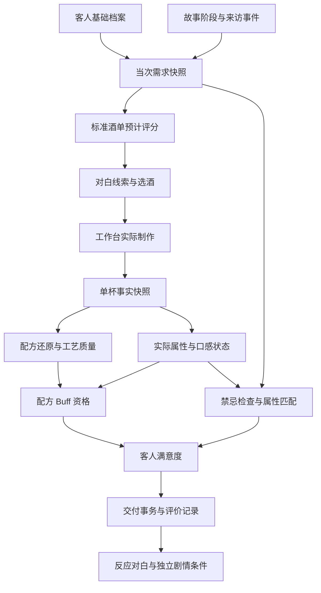

# 客人偏好与酒品评价机制 数据与判定规范

版本：v0.1（附实现更新） ｜ 编写：2026-10-04 / 更新：2026-10-09 ｜ 适用项目：《致未归的客人》Godot 游戏

面向：策划、人物与剧情编写同事、工作台开发、图鉴与酒单开发、测试。

**核心机制：客人的基础偏好与当次事件形成需求，系统根据玩家实际交付的酒计算口味匹配，再结合有效 Buff 得到满意度；制作质量独立评价，剧情按明确条件触发。** 规范制作的酒不一定合客人口味，改编酒也可能更受欢迎。

本文保留原设计契约，并新增 2026-10-09 实现进度。已接入和仍待扩展的部分以该节为准。“后台”指 Godot 中的数据配置、计算服务与存档职责，不要求搭建联网服务器。

用户已授权采用更合理的建议。因此，本文补充的结构与判断规则作为本版建议接入基线，可以据此拆任务，不需要逐项再次确认。评分参数提供可直接试跑的初始配置，仍属于试玩数值；人物专属设定、未提供的物料换算及传说剧情不会被凭空补成事实。

阅读方式：策划和人物同事先读第 1、3—9、14、16 节；程序同事重点读第 2、5、10—12、15 节。第 7.4 节给出可复算的数字案例，第 10 节给出数据契约，第 15 节可直接拆成开发和测试任务。

## 2026-10-09 实现进度与试玩口径

下文保留原设计规范，**当前已实现范围以本节为准**：顾客交付、四维口味匹配、明确禁忌拒收、售价与小费结算、手帐、DIY上架及配方版本管理已经接通。人物专属数值采用集中配置的试玩建议，不是正式剧情设定；其他角色小游戏本次按用户最新决定保留设计，小线仍为无剧情奖励的演示。

### 玩家流程

1. 与当前客人聊天后进入选酒页；显示当次口味与要求，并冻结本次需求。
2. 选择营业酒单上的酒（包括已上架DIY）开始制作；保存配方版本、来访编号和这次售价。中途改酒单不会改这杯价格。
3. 完成制作后仍先看工艺品质；按空格或“交给客人”交付，随后显示客人的满意度、原因、实收酒款及小费。
4. 返回酒馆可看到客人的反应；玩家自行送客。顾客评分与工艺分分别记录，手帐可以查看，重复的饮后反应会去重收录。
5. **04:00仅停止接新客，不强制结束当前接待。** 时间停留在收工边界，半成品、订单和客人保留；完成、交付、看完评价并送客后结束营业。期间可补货、重做、返回页面；退出重启仍保留最后一位客人。

### 配置与计算

- `data/guest_service.json`：五位客人的试玩目标、权重、容忍区间、限制、事件入口及小费档位。对称偏差算法采用本文7.2节；工艺分不乘入口味分。
- 当前小费建议：满意度≥90时20%，≥70时10%，否则0；按整数金币四舍五入。受理酒款按开工时售价收费；拒收0金币且评分为null。遗留小数售价在订单中转换为整数金币。
- `guest_evaluation.gd`只计算，不操作存档、库存或钱包。硬性限制先判；含酒信息未知且要求无酒精时阻止交付，不假装合规。奶制品限制读取原料的`dietary_tags: ["dairy"]`，新增奶制品必须填此字段。当前糖是已配置的固体甜度贡献，不将糖误认成果肉。
- 新制作会话统一采用`research-sensory-2`，按实际杯中组成计算浮点属性。营业和研发共用算法；图鉴与选酒页读取同一算法的标准预测。修改目标酒谱不改变实际属性；混合影响分层和工艺状态，不凭空改变整杯成分比例。
- 原始策划属性仍留在`data/cocktails/catalog.json`，菜单投影另保留`design_attributes`；界面标明“统一感官试算”。例如莫吉托原40/35/45/0未从源文件删除，新模型值并非伪称原表定稿。旧已完成的杯保持冻结结果；新杯记录模型版本。
- `dash`换算仍未知的标准配方标记`attributes_complete=false`，不编造换算；实际量取的ml可正常计算实际杯。
- 正式事件与配方Buff表默认空。接口只使用明确配置，不凭空发传说效果；人物剧情触发、传说奖励及复杂萃取/融水仍属于内容和后续模型扩展。

### 事务与后台归属

| 文件/对象 | 职责 |
| --- | --- |
| `GuestService` / `guest_service.gd` | 冻结需求、生成订单、校验当前来访与单杯、发起/恢复交付 |
| `guest_service_data.gd` | 校验需求、订单及交付账本的持久化结构 |
| `WorkbenchSession.state.service` | 与库存/制作共用Supplies原子存档，保存需求及交付pending/complete记录 |
| `SlotWallet.sale_receipts` | 保存唯一销售凭据及收款金额，重复调用不加钱 |
| `result.customer_receipt` | 该杯的冻结评价、付款、拒收状态和反应；供手帐读取 |
| `GameSession.visit.id/closing_pending/closing_day` | 稳定来访编号和延后收工状态，恢复时不重新抽客人 |

交付顺序为：先持久化pending意图 → 钱包按`receipt.id`幂等入账 → 一次原子写入单杯凭据和complete标记。钱包写失败回滚余额；钱包已成功而单杯写失败时，重启补写凭据，不重复入账。不退已用材料、不重复扣料。同一来访只能交付一杯；已离店旧客人的酒不能交给新客人。只有旧版无订单的杯时，需要重新从选酒页开工，不自动追补历史销售。

### 研发配方管理

- 研发收藏增加管理页：修改名称/英文名/笔记保存新版本；可逐版本查看并对比用料。
- 从已有DIY开始新试调后，可“另存为新配方”或“修订原配方”。修订保持ID、增加version，并保留旧版本；不覆盖官方酒谱。
- 修改、删除均校验`expected_version`；过期操作不覆盖新修改。
- 正在制作的杯保留开工时配方快照，旧消费记录也不改写。上架中的配方修订后后续新杯使用新版，售价保持原值。
- 删除要求先下架；从在用收藏中移除，但保留历史版本与原单杯的保存凭据，防止同一杯重复保存。
- `data/research.json.max_saved_recipes=64`为试玩上限；达到后可以修订或整理收藏。已有超限存档不自动删除。
- 完整可编排工艺步骤、真实萃取、任意冰量及正式传说内容仍未伪装为现成功能。

### 验证与已知边界

已增加真实UI/服务测试：交付、重复点击、旧来访拒绝、禁忌拒收、钱包写失败、收款后单杯写失败、另进程恢复；04:00保留客人、重启续杯并交付、手动送客收工；配方改名、新试调修订、旧版本不变、上架删除拦截及删除后重载。测试均使用独立`/tmp`下七份存档路径，不修改玩家存档。

旧版未记录过的历史对白不能补造。部分原有测试进程退出仍有ObjectDB/资源释放告警，本轮不宣称零告警；功能断言和脚本解析错误另行检查。

---

## 目录

1. [来源与决策状态](#1-来源与决策状态)
2. [现有工程与需要补齐的部分](#2-现有工程与需要补齐的部分)
3. [统一概念与数据归属](#3-统一概念与数据归属)
4. [客人当次需求](#4-客人当次需求)
5. [酒的标准属性与实际属性](#5-酒的标准属性与实际属性)
6. [风味标签与配方 Buff](#6-风味标签与配方-buff)
7. [满意度计算与判定顺序](#7-满意度计算与判定顺序)
8. [酒单推荐与对白](#8-酒单推荐与对白)
9. [剧情与奖励触发](#9-剧情与奖励触发)
10. [后台配置与数据契约](#10-后台配置与数据契约)
11. [Godot 模块与接口](#11-godot-模块与接口)
12. [状态存档与重复提交](#12-状态存档与重复提交)
13. [DIY 研发接入](#13-diy-研发接入)
14. [现有数据迁移与协作流程](#14-现有数据迁移与协作流程)
15. [开发任务与验收案例](#15-开发任务与验收案例)
16. [待定事项与首版边界](#16-待定事项与首版边界)

## 1 来源与决策状态

### 1.1 依据

- 用户提供的《客人有偏好.docx》。包含基础偏好、事件修正、数值与 Buff 评分、传说效果及章节构想。
- 用户提供的《20261003195730-转写_冯琪原的快速会议-逐字稿文本-1.docx》。重点参考约 00:27—00:44 的偏好与 Buff 讨论、00:52—00:58 的最终评分澄清。转写存在错字，不据此新增酒名或更改人物身份。
- 本次对话已整理的机制理解，以及仓库当前工作台、客人、剧情、图鉴、原料和酒单代码。

会议较早讨论过实时 AI 匹配与生成反应；约 00:53—00:58 明确可以用规则匹配、固定文本，AI 主要帮助开发时编写内容。本文采用这一较晚澄清。会议中的操作建议仅作为设计资料，不视为修改工程或发布的独立指令。

### 1.2 状态标记

| 标记 | 含义 |
| --- | --- |
| 已确认方向 | 用户文件与后续澄清明确表达的玩法原则 |
| 现有实现 | 已在当前仓库中核对到的行为，可能仍为试玩版本 |
| 建议契约 | 根据用户授权采用的本版接入基线，尚待实现与验证 |
| 示例参数 | 可用于初次联调的试玩数字，不是平衡定稿 |
| 待定 | 尚无足够依据，不能由程序自行猜测 |

除明确写为“现有实现”的部分外，下文的新增字段、服务名、状态和算法均属于**建议契约**。JSON 示例是文档中的结构示范，不会被游戏自动加载；`example_` 开头的内容不代表正式人物或传说配方。

### 1.3 已确认方向

1. 客人先有基础偏好，来访事件或心情在此基础上修正。
2. 最终评价与客人当次需求比较，而非与系统推荐酒比较。
3. 酒单推荐按规范制作时的预计满意度排序，当前最好也可能不够满意。
4. 成品的酒感、甜、酸、苦独立使用 0—100 刻度；酒感不等于 ABV。
5. 配方还原与客人喜欢分开；玩家可以通过改编提高口味匹配。
6. 属性得基础分，符合条件的 Buff 得附加分；传说 Buff 与解锁、配方和完美制作有关。
7. 特殊事件可以来自满意度，也可以来自独立的剧情条件。
8. DIY 与传说配方来源分开；保存 DIY 不自动上架。

普通 Buff 的门槛、满意阈值、传说加分和特殊 CG 门槛采用下文的试玩基线，后续根据测试调整，不能把初始数值当成内容定稿。

## 2 现有工程与需要补齐的部分

以下为 2026-10-04 检查结果，代码变化后应同步更新此表。

| 现有文件或服务 | 当前职责 | 本机制接入时的变化 |
| --- | --- | --- |
| `data/guests.json`、`scripts/guest_spawner.gd` | 五位客人的形象、介绍、文字偏好与 `avoid`，客人出现逻辑 | 保留人物 ID；另加数值偏好及类型明确的限制 |
| `data/story_dialogues/`、`StoryDialogue` | 连续故事、相识状态、分支与个人进度 | 用稳定故事 ID 关联事件修正；不把评分公式写进台词节点 |
| `data/cocktails/catalog.json`、`CocktailDatabase` | 正式酒款资料、四维属性、风味与口感标签 | 增加统一计算结果与版本来源，避免标准值和实测尺度分离 |
| `data/supplies/catalog.json`、`Supplies` | 商品 SKU、计量单位、含酒信息、库存与消耗 | 新属性模型通过 SKU 引用；库存仍由 Supplies 唯一维护 |
| `MenuCatalog` | 酒单、解锁状态、库存展示镜像 | 提供推荐候选，不拥有满意度算法或库存扣减权 |
| `WorkbenchSession` | 配方快照、操作、容器、实际消耗、单杯结果 | 成品结果关联来访与订单；保持制作和交付分离 |
| `workbench_liquid_state.gd` | 分层、混合、按实际液层转移 | 为实际成分与混合状态提供事实，不直接发放 Buff |
| `workbench_evaluation.gd` | 配方／过程／出品质量、成品属性、描述词 | 拆出独立实际属性计算，保留工艺评价 |
| `GameSession` | 时间、接待、剧情营业快照 | 接入当次需求与交付事务，设计明确存档迁移 |
| `home.gd:on_drink_served()` | 当前直接衔接送客及下一位客人 | 不能直接作为新评分或结算入口，应在交付与反应完成后调用或替换 |

**现有缺口：** 客人尚无完整数值偏好及来访修正；工作台结果仍记录 `sales: false`，制作模块不执行销售或客人结算；没有完整的“当次需求—实际杯—满意度—剧情奖励”闭环。旧故事 README 中“工作台仍是预览页”等描述已落后于工作台现状，接入时以实际代码为准。

**现有属性算法需要调整：** 当前大致采用 `配方目标值 + (实际原料均值 − 标准原料均值) × attribute_gain`，部分过程修正也读取所选配方。相同实际材料与过程因此可能因目标酒谱不同得到不同属性。新模型必须保证实际属性不依赖所选配方；配方仅用于还原检查与 Buff 身份判定。

**当前工艺试玩规则：** 配方、过程、出品权重为 60%／30%／10%；评级起点为完美 95、优秀 80、一般 60、欠佳 35、糟糕 0，并有用量与缺料等限制，不能只检查总分是否达到 95。它们是现有工艺规则，不是新客人满意度规则。

## 3 统一概念与数据归属

### 3.1 六个不能混用的对象

| 对象 | 简写 | 含义 | 谁可以修改 |
| --- | --- | --- | --- |
| 客人基础档案 | Profile | 稳定的人设、基础偏好与限制 | 内容配置维护者 |
| 当次需求快照 | Demand | 本次实际使用的偏好、权重、容忍范围与限制 | 来访服务创建；锁定后不可覆盖 |
| 配方定义及版本 | Recipe | 想复现的标准做法、配方身份、目标展示 | 官方内容或 DIY 修订流程 |
| 单杯事实 | Drink | 实际入杯材料、操作、状态、杯型及外观 | 工作台命令，完成后冻结 |
| 工艺评价 | Quality | 对所选配方的还原与制作水平 | 工艺评价纯函数生成 |
| 客人评价 | Satisfaction | 这位客人对这一杯的匹配、加减分和反应 | 客人评价纯函数生成；交付后冻结 |

制作失败、保存 DIY、获得 Buff、交付、销售和剧情推进是不同事件。图鉴标准酒谱不能被实际单杯覆盖，客人喜欢也不能反过来修改实际成品属性。

### 3.2 统一命名与单位

- 属性键统一为 `alcohol_intensity`、`sweetness`、`sourness`、`bitterness`。使用具名对象；不把文档中不同排列顺序的四个数字直接当数组读取。
- 属性独立取 0—100，不要求总和为 100。内部保留浮点值，展示时再取整；门槛使用未取整值。
- 人物沿用 `milo`、`ada`、`hank`、`stick`、`yellow_creature`；配方沿用 `last_word`、`mojito`、`gin_and_tonic`、`long_island_iced_tea`、`manhattan`。
- 原料用商品 `sku_id` 做跨模块关联。工作台历史别名 `gin`、`lime` 等仅在适配层转换，不新建一套同名材料。
- 液体单位为 ml，固体质量为 g，叶／片／块等数量保留对应计数单位。转换必须来自明确配置；未知换算用 `null`，不能填 0。
- `recipe_id`、`recipe_version`、`session_id`、`drink_id`、`visit_id`、`order_id`、`delivery_id` 各有用途，不能互相替代。
- 本文所有示例 ID 都是完整字符串，不根据中文名猜测对应关系。

### 3.3 总体数据流



推荐使用规范制作的预测杯，最终评价使用玩家实际杯，两者调用同一评分模型，但不能复用同一个分数。

## 4 客人当次需求

### 4.1 基础值与事件修正

对每项属性 `i`：

```text
target[i] = clamp(base[i] + permanent_delta[i] + sum(active_event_delta[i]), 0, 100)
```

- `base`：人物稳定偏好；不是根据当前酒单反推的数值。
- `permanent_delta`：可选，长期人物变化；必须由明确剧情事件写入，首版可全为 0。
- `active_event_delta`：本次生效的临时修正。每次从基础档案计算，不能把上次临时结果再当基础值。
- 建议首版每次只有一个主要事件；将来多事件叠加时按唯一事件 ID 去重，相加后统一截断。
- 同一“失恋”主题对不同人物可以有不同修正，甚至完全不同的方向。

文档示例：酒感 30、甜 80、酸 50、苦 40；本次酒感 +30，得到酒感 60、甜 80、酸 50、苦 40。这只是结构示例，不直接写入米洛或任何现有角色。

### 4.2 权重与容忍范围

每项同时保存 `weight` 与 `tolerance`：

- 权重越大，该项偏差越影响分数；权重 0 表示本次不在意该项。所有权重总和必须大于 0。
- 容忍范围是目标附近不扣基础分的区间，例如目标 80、容忍 5，对 75—85 同等接受。
- 首版建议先用固定权重和容忍范围，让事件主要修改目标值，避免参数太多无法调试。
- 后续需要“太甜比不够甜更难接受”时，可以添加方向不同的惩罚系数；首版暂不引入。

### 4.3 软偏好与硬性限制

| 类型 | 示例 | 处理 |
| --- | --- | --- |
| 四维目标 | 喜欢低甜 | 用甜度目标、权重表达，不重复加一条同义扣分 |
| 软性口感偏好 | 不喜欢气泡 | 按实际气泡状态扣分，仍可以接受 |
| 配方 Buff 偏好 | 获得某清爽 Buff 时 +5 | 仅对通过资格检查的 Buff 计分 |
| 硬性限制 | 本次明确要求无酒精 | 先判是否违反，普通或传说加分不能抵消 |
| 制作要求 | 不额外加糖浆 | 比较实际使用记录与明确的允许范围 |

建议限制记录包含：`id`、检查对象、`scope`、条件和违反后的处理。其中 `scope` 必须明确是 `served_contents`（实际交付组成）、`served_contact_history`（进入这杯酒的接触来源）、还是 `preparation_actions`（制作操作）。

例如只是不喜欢果肉，可以在过滤后不再判为含果肉；若设定为不能接触某种原料，不能因滤掉固体就清除已记录的接触。这里是游戏中的内容约定，不模拟现实过敏风险。没有接触追踪数据时不能假装满足此类规则。

`contains_alcohol` 使用 `true / false / null`：含酒为真、确认无酒为假、资料不足为未知。任何入杯成分确认含酒则成品为真；其余均确认为无酒才是假；剩余情况为未知。ABV 缺失不影响已确认的“含酒”事实；酒感 0 不能证明无酒精。

### 4.4 当次需求锁定

建议状态为 `draft → locked`。来访时可创建草稿；如果对话选择会改变心情，先应用这次选择，再生成最终需求。**最迟在展示点单线索或首次进入选酒页时锁定。** 首版没有选择影响口味时，可以来访时直接锁定。

锁定后打开商店、返回酒单、重新调酒、切换页面、重载存档都不能重抽事件或重算出不同目标。剧情确需中途改变订单时，关闭旧订单并创建新 `order_id` 与需求版本，不覆盖已开始制作的订单。

`guest_visit_index` 是该客人的来访序号，`story_episode_id` 是故事段落 ID，二者不能假定相等：同一故事可能跨多次来访才能结束。

## 5 酒的标准属性与实际属性

### 5.1 实际属性的唯一输入

新实际属性计算服务只接受**实际杯中组成、相关操作和模型快照**，不接受配方目标值作为属性修正基准。

应满足：同一模型下，相同实际组成与相关处理状态，得到相同实际属性；更换目标酒谱、改酒名、改变图片、切换顾客不能改变属性。

仅统计真正进入出品杯的部分。留在容器中、已倒掉和已洒漏的原料仍计入成本或浪费，但不计入口味。当前分层倒出会改变实际入杯配比，不能用整壶平均配比替代实际转移记录。

### 5.2 建议的首版感官近似模型

先建立独立 `sensory_model`，以实际量计算感官贡献。液体贡献使用统一参考浓度，固体贡献使用单位对应的系数，不做跨单位的直接平均。

```text
V = 成品杯实际液体体积 ml

C[i] = (sum(液体体积 ml × 该原料每 ml 的属性贡献[i])
      + sum(固体实际量 × 对应单位贡献[i] × 有效释放比例)) / V

actual_attributes[i] = clamp(calibration_curve[i](C[i]) + process_delta[i], 0, 100)
```

该式是游戏模型，不声称符合真实味觉化学。所有系数、校准曲线、释放比例均是待试调配置；首版可以使用线性曲线，但所有酒必须共用同一模型，不能为迁就某杯目标值暗中叠加配方专属偏移。

具体边界：

- `V <= 0` 的空杯不能计算成正常饮料或交付，不用极小分母制造满分。
- 融水将来加入时，以真实记录的水体积进入分母且感官贡献为 0，不重复扣库存。**当前尚未实现融水模型，本规范不假定已有融水。**
- 糖、薄荷等是否产生贡献，由溶解／轻压／浸入规则定义；未配置的规则标记为未知，不把所有装饰自动加入酒液贡献。
- 杯沿装饰默认仅贡献外观；若设计为可食、浸入或挤汁，应有明确动作或规则。硬性成分检查仍按该限制的范围处理。
- 未知的 dash 换算不能用 0 ml 参与计算。原料实际用量已知时可算实际杯，标准杯预测仍要标为资料不完整。
- 新增原料缺少感官资料时，不沿用“缺失即四项 0”的旧回退。可保留单杯记录并返回 `data_incomplete`，不能给出权威的完美评级或发放传说奖励。

完整性按本次计算所需的数据检查，不要求所有未来字段都齐全。比如本次只需要感官属性和“是否含酒”，已有 `contains_alcohol: true` 即可判定含酒，ABV 未填写不应额外阻止普通评分；但未知原料是否含酒、且当前客人明确要求无酒精，就不能声称已经通过该限制。温度、融水模型尚未启用时也不以缺少这些未来数据为由阻断所有杯。

### 5.3 过程影响与分层

建议先把“整体属性”与“口感状态”分开：

| 实际行为 | 应影响什么 | 不应发生什么 |
| --- | --- | --- |
| 充分搅拌 | 混合均匀程度，配置支持时影响溶解与气泡保留 | 仅因选择某款配方就凭空增加酸度 |
| 摇和气泡原料 | 气泡保留状态及相关风味资格 | 无依据地改写其他材料的数量 |
| 轻压薄荷 | 有效草本释放及口感；过度轻压以后可扩展 | 没有轻压也自动获得完整草本效果 |
| 分层后只倒出部分 | 实际杯中的组成与四维属性 | 用整壶平均值当作这杯属性 |
| 全部入杯但未混合 | 整杯四维平均属性相同，均匀程度不同 | 仅凭颜色分层随意推断更甜或更酸 |
| 过滤 | 冰、固体和相关状态的转移 | 将已溶解风味或含酒事实自动删除 |

首版建议用整杯平均属性匹配四维需求，把分层／不均匀作为独立状态。未混匀不必无条件扣分，因为未来可能有合法分层配方或客人偏好。顾客逐口品尝、首口与尾味变化属于后续扩展，不在首版冒充已经模拟。

过程事实计算必须与“配方要求是什么技法”的工艺检查拆开。现有动作回放中依赖 `rule.mix` 的部分只能用于工艺还原，不能直接当成统一口感事实。

### 5.4 标准配方属性的来源

建议建立标准杯生成流程：按配方的规范用量、标准操作和出品方式构造预测杯，再调用同一实际属性服务。产物记为 `standard_attributes`，并保存模型版本、配方版本与数据完整性。

现有图鉴数值保留为策划目标／来源记录，与新计算值生成差异报告。尤其 A2 莫吉托现有 40／35／45／0 是来源确认值，不能为了算法统一直接静默覆盖。应校准公共模型、展示差异并由策划确认迁移方案；若必须调整旧目标，记录原因及版本。

接入完成后，图鉴展示、推荐预测与规范制作结果应使用同一发布版本。禁止一个界面读旧目标、另一个界面读新属性，却都标成同一种“酒属性”。

金汤力统一引用 `gin_and_tonic`，杯型以高球杯为准。标准杯生成也要经过真实容量与冰占位规则；配方装不下时报告内容错误，不能为了预测而假装所有材料都进杯。

## 6 风味标签与配方 Buff

### 6.1 四个独立命名空间

| 类别 | 建议示例 ID | 用途 |
| --- | --- | --- |
| 实际风味／口感 | `mouthfeel.carbonated`、`flavor.herbal` | 表达这杯实际存在的特点 |
| 普通配方 Buff | `buff.refreshing` | 合格配方授予的普通奖励资格 |
| 传说 Buff | `buff.first_love` | 特定已解锁传说配方的效果资格 |
| 展示描述词 | `descriptor.too_sweet` | 解释工艺或客人感受，不直接参与奖励 |

当前 `evaluation.tags` 中的“齁甜的”“清爽的”等有显示数量限制，不能直接视为有效 Buff 列表。逻辑列表完整保存，界面可以只选显示最重要的几项，不能因为 UI 只显示两项就少算奖励。

“太甜”还要明确比较对象：相对配方太甜属于工艺偏差；相对客人太甜属于口味偏差。同一杯可能偏离经典配方，却正好符合喜甜客人的目标。对白应根据客人偏差生成。

### 6.2 建议的普通 Buff 获得规则

1. 所选配方及版本明确声明可以授予该 Buff。
2. 必需材料、替代范围、剂量误差、关键操作达到该 Buff 规定的还原要求。
3. 该 Buff 要求的实际口感状态仍存在，例如有气泡且未明显消散。
4. 若 Buff 额外要求工艺级别，则检查级别；普通 Buff 不一律要求完美。
5. 数据完整，无禁止该效果的条件。

合理误差应通过配置明确，例如某材料的相对误差上限与可选装饰规则。本版普通 Buff 的试玩基线为：必需液体各自相对标准用量误差不超过 10%；没有未许可的额外原料；必需固体数量及关键操作符合要求；可选装饰不作硬门槛。具体配方可以覆盖此配置。该 10% 与当前用量推荐区间取同一初值，但它们是不同规则；修改交互黄金区间不会自动修改 Buff 门槛。

客人对“实际有气泡”的软偏好可以单独配置；若同时配有“气泡配方 Buff”，必须明确是否允许两项叠加。建议首版同一喜好选一种计分渠道，避免同一效果重复奖励。

### 6.3 传说 Buff 获得规则

```text
配方已正式解锁
AND 所选配方身份为指定传说配方
AND 本杯配方版本在允许范围内
AND 满足该配方的还原与特殊条件
AND quality.tier == perfect
AND 相关数据完整
→ 激活该传说 Buff
```

相同名字、相同四维、相同颜色或复制成 DIY，都不能获得传说资格。是否允许后来修订的传说版本，必须由 Buff 规则明确。解锁状态在开始制作时检查并记录，交付检查合法来源；不能只相信 UI 传来的 `unlocked: true`。

Buff 激活和客人加分分两步：一杯酒可以带有传说效果，但不是每位客人都对此产生相同共鸣。客人／事件的 `buff_affinities` 决定加分，未配置的效果默认 0 分，不能自动全部 +100。

### 6.4 去重与上限

- 按稳定 `buff_id` 去重；重复装饰、重复点击、两条授予规则命中同一 Buff 都只算一次。
- 默认按布尔资格授予，不因多加同一材料不断叠加；强度分级以后另加规则。
- 普通加分总上限、普通扣分下限分别配置，首版建议有上限以避免堆标签压过四维匹配。
- 传说奖励单列，不与普通奖励上限混用；多传说能否叠加暂不开放，首版每杯至多一个传说效果。
- 所有未获得的 Buff 应保存原因，例如 `recipe_mismatch`、`quality_not_perfect`、`missing_state`、`recipe_locked`、`data_incomplete`，方便调试和解释。

## 7 满意度计算与判定顺序

### 7.1 交付评价固定顺序

1. 校验来访、订单、单杯和版本引用；同一杯不能交付两次，不能交给已离店的旧订单。
2. 校验数据完整性与成品可交付性；空杯、未知必要数据返回明确错误，不算作普通低分。
3. 计算实际属性、状态与独立工艺评价，读取已冻结结果时校验其版本和来源。
4. 检查硬性限制。确定违反则返回 `rejected`；未知则返回 `data_incomplete`，不猜测“没有”。
5. 计算四维属性基础分。
6. 判定配方 Buff 是否有效，再根据该客人当次亲和度计算加分；软性口感扣分单列。
7. 合成满意度并确定满意／不满意。
8. 生成结构化原因、对白选择键和剧情候选事件。
9. 由交付事务服务一次性提交结果；纯评分函数不扣料、不收款、不推进剧情。

建议被拒收时 `satisfaction_score = null`，状态明确为拒收，基础分如需调试可另存为 `diagnostic_match`。不能简单写成 0 分后，又被其他逻辑补上 Buff。拒收是否收费由销售规则另定，不能由评分服务决定。

### 7.2 四维匹配公式

对每项属性：

```text
signed_difference[i] = actual[i] - target[i]
effective_error[i] = max(0, abs(signed_difference[i]) - tolerance[i])
weighted_error = sum(weight[i] × effective_error[i]) / sum(weight[i])
base_score = clamp(100 - penalty_scale × weighted_error, 0, 100)
```

`signed_difference` 保留方向，供对白解释“太甜”或“不够甜”；评分使用有效偏差。基础模型使用对称偏差，特殊人物以后可以扩展不对称惩罚，但不能散落在 UI 中临时修改。

### 7.3 总分与状态

```text
ordinary_bonus = clamp(sum(有效普通 Buff 的正向加分), 0, 普通加分上限)
soft_penalty = clamp(sum(软性状态偏好的负向扣分), -软扣分上限, 0)
legendary_bonus = sum(有效传说 Buff 的当次共鸣加分)
satisfaction_score = max(0, base_score + ordinary_bonus + soft_penalty + legendary_bonus)
status = satisfied if satisfaction_score >= satisfied_min else unsatisfied
```

首版正向普通奖励走 Buff 渠道；软性实际状态只作扣分渠道，避免“气泡存在”与“气泡 Buff”双加分。若以后允许直接口感加分，应新增明确的独立字段与去重组，不能把正数塞进扣分字段。

满意度允许超过 100；基础分、工艺分仍是 0—100。总分不再强行截断到 100。UI 建议分别展示“口味匹配”“配方奖励”“特殊共鸣”，不要显示“200／100”。

工艺分不直接乘进满意度，也不再作为一个默认扣分项，避免配方偏离与其造成的实际口味变化被重复惩罚。质量通过 Buff 门槛与客观过程结果产生影响。选错推荐配方本身不扣分；未来明确指名且必须交付某款的订单，另设 `order_requirement`，不偷偷加入普通订单。

### 7.4 一套可复算的测试参数

**作为首轮联调及本文案例的初始配置，均为试玩参数。落地时集中保存在评分配置中，不写死在界面或人物台词里。**

| 参数 | 示例值 |
| --- | --- |
| 四维权重 | 各 1 |
| 四维容忍范围 | 各 5 |
| `penalty_scale` | 2 |
| `satisfied_min` | 70，含 70 |
| 普通 Buff 单项加分 | 5 |
| 普通正向加分总上限 | 10 |
| 软性扣分总上限 | 20 |
| 指定传说共鸣 | 100 |
| 示例特殊事件门槛 | 200，含 200，还需满足剧情条件 |

目标为酒感 60、甜 80、酸 50、苦 40：

| 实际杯 | 有效偏差 | 基础分 | 普通奖励 | 传说奖励 | 总分 |
| --- | --- | ---: | ---: | ---: | ---: |
| 酒感 40、甜 65、酸 50、苦 40 | 15／10／0／0 | 87.5 | 10 | 0 | 97.5 |
| 酒感 58、甜 77、酸 52、苦 42，改编失去原配方 Buff | 0／0／0／0 | 100 | 0 | 0 | 100 |
| 四维完全符合，且满足指定传说条件 | 0／0／0／0 | 100 | 0 | 100 | 200 |
| 与第二杯相同，但违反硬性禁忌 | 不进入正式基础分结算 | — | — | — | `null`，拒收 |

第一行计算：平均有效偏差 `(15 + 10) / 4 = 6.25`；基础分 `100 − 2 × 6.25 = 87.5`。第二行说明改编可以比标准酒更合口味。第三行说明“超过 200”与“达到 200”不同，内容必须明确比较符号。

边界判定使用未取整数值。例如 69.6 显示为 70 仍不应与“70 分满意”产生矛盾；建议临界分显示一位小数或仅显示状态，不能用展示取整后的值重新判定。

## 8 酒单推荐与对白

### 8.1 推荐候选

建议候选必须同时满足：已上架、已解锁、数据可计算、符合当次硬性限制。库存与器具是否足够作为独立可制作状态，由库存与制作规则检查，不由评分服务扣料。

返回两组结果：

- `recommended_now`：现在可制作候选中预计满意度最高者。
- `best_match_on_menu`：已上架的合规候选中最合口味者，可提示缺货；没有则为 `null`。

这样缺货不会被解释为“客人改变了口味”。既可以保留客人喜欢什么的线索，也可以引导玩家去商店补货。无合规候选时返回明确原因，不强行推荐违反禁忌的酒。

算法：对标准预测杯调用与交付相同的属性与评分函数；不消耗库存，不发放剧情奖励。按未取整预计满意度降序，同分按酒单顺序、再按 `recipe_id` 稳定排序。没有随机偏移，除非以后加入明确的并列候选偏好规则。

库存、上架内容变化可以刷新可制作推荐，但不能改变已锁定的需求。已生成的对白与当时推荐记录保留，不在玩家买东西后重写历史台词。酒单编辑不会改写正在制作的配方快照。

### 8.2 对白事实来源

点单提示读取需求快照，交付反应读取评价记录。剧本文案可以有多种表达，但必须表达同样的事实。

| 输入 | 可选表达方向 |
| --- | --- |
| 酒感目标较高且权重高 | 今天想要更明显的酒感 |
| 甜度目标较低 | 别太甜，想喝得清爽些 |
| 实际甜度超过目标容忍区间 | 对我来说有些甜了 |
| 工艺高、口味不合 | 做得很讲究，不过不是我今天最想喝的味道 |
| 工艺还原低、口味合适 | 和我记得的做法不同，但这次很合口味 |
| 指定传说共鸣有效 | 进入对应人物和剧情阶段的专用对白 |

后台保存结构化原因，例如 `attribute_too_high`、`sweetness`、目标、实际、容忍范围、扣分贡献。对白按最大有效扣分选主因；若总体满意，可使用“有些……但……”的模板，不能因存在一个偏差就必定播放拒绝台词。

需求关键词可在 UI 加粗或用标记强调；标记仅负责显示，不能通过解析中文台词来生成需求。避免出现“说无气泡，但后台喜欢气泡”的冲突。

### 8.3 AI 的位置

首版建议离线辅助生成角色草案、事件修正草案和对白，由策划审核后进入版本化 JSON。运行时由规则确定分数、Buff 和剧情；不依赖联网 AI 才能交付。

以后如增加即时文案润色，只把已确定的事实交给模型；模型输出不允许修改分数、需求、库存、解锁或奖励。异常时回退本地模板，不阻塞营业。

## 9 剧情与奖励触发

### 9.1 满意度和剧情使用不同规则

剧情规则由条件集合表达，建议至少支持：人物、故事阶段、事件、订单状态、有效 Buff、满意度门槛、过去不同来访的结果、尚未领取。

```text
guest_id == 指定人物
AND story_episode_id == 指定阶段
AND buff.first_love 已生效
AND satisfaction_score >= 配置门槛
AND 未领取该事件奖励
→ 生成特殊事件候选
```

不是所有人物喝到传说酒都会触发同一 CG；高分也不能跳过必要的故事阶段。首版条件只允许声明式操作符，如 `eq`、`gte`、`has`、`all`、`any`，不在 JSON 中嵌入任意脚本。

### 9.2 优先级与特殊分支

建议先处理交付失败／数据不足，再处理拒收分支；合法交付后在特定剧情、满意反应、不满意反应中按显式优先级选对白。奖励事件可独立列表保存；互斥剧情使用 `exclusive_group`，不能依赖文件遍历顺序。

与异常酒相关的剧情可以不要求满意，但必须声明条件；不得默认所有不满意都解锁隐藏奖励。剧情中的“醉酒”首版宜用明确的虚构事件条件，不能把酒感 0—100 当作真实摄入酒精量。以后需要独立建模时再补齐实际含酒量与角色状态规则。

### 9.3 多次来访与一次性奖励

- “连续三次满意”默认按同一客人的三个不同来访、各自一次正式交付累计；连续指该客人的连续合格来访，不是全店客人顺序。
- 同次来访重做、重复交付请求、打开评价窗口、重新播放对白都不增加次数。
- 无交付来访是否打断连续记录是内容参数，需显式配置；建议首版忽略未完成来访，并记录此策略。
- 用 `event_rule_id + guest_id + story_arc_instance_id` 形成一次性奖励键。单杯事件还应关联 `delivery_id`。
- “触发事件”“展示 CG”“领取奖励”分开记录。崩溃后可恢复播放，已领取奖励不能再发。
- 原故事“聊完一章”的完成语义保持不变；喝酒结果满足的是新的饮酒事件条件，不直接假设应再推进一个故事章节。

## 10 后台配置与数据契约

### 10.1 文件组织与唯一数据来源

以下新增路径均为建议，**本次没有创建这些运行配置或脚本**。不要求立刻把所有文件做成独立服务，但不能让不同界面各自维护同一数值。

| 路径或存储位置 | 状态 | 数据归属及写入者 |
| --- | --- | --- |
| `data/guests.json` | 已有 | 人物基础展示，不复制第二套姓名、头像或人物 ID |
| `data/guest_mechanics/profiles.json` | 新增建议 | 按 `guest_id` 保存偏好、权重、容忍和限制，策划维护 |
| `data/guest_mechanics/visit_events.json` | 新增建议 | 按故事 ID 关联事件及临时修正，人物同事维护 |
| `data/guest_mechanics/scoring.json` | 新增建议 | 全局满意度参数与模型版本，策划与程序共同维护 |
| `data/guest_mechanics/buffs.json` | 新增建议 | Buff 定义、授予条件和上限规则，不存客人单独加分值 |
| `data/guest_mechanics/reactions.json` | 新增建议 | 反应模板及允许使用的原因，人物同事维护 |
| `data/guest_mechanics/story_triggers.json` | 新增建议 | 剧情条件、奖励及一次性规则，剧情同事维护 |
| `data/workbench/sensory.json` | 新增建议 | SKU 感官贡献、校准曲线、过程规则，唯一感官模型 |
| `data/workbench/evaluation.json` | 已有 | 保留工艺评级配置；迁移后不再维护另一份正式感官原料配置 |
| `data/cocktails/catalog.json` | 已有 | 正式配方；增加或关联版本化 Buff 授予规则和标准杯派生结果 |
| `data/supplies/catalog.json` | 已有 | SKU、计量、含酒信息、外观等商品事实；感官文件通过 SKU 引用 |
| `user://game_session.json` 的新版本 | 扩展建议 | 来访、需求快照、订单、交付账本、剧情效果应用状态 |
| 工作台现有存档 | 已有并扩展 | 制作与单杯原始事实；交付账本另外保存所引用成品的不可变快照 |

静态配置只读，玩家状态写入 `user://`。不要把本次玩家心情、库存或满意度写回 `res://data/`。SQLite 是现有酒款数据导出副本，不新增一套在运行时独立评分的数据来源。

### 10.2 客人档案示例

下面是孤立的测试人物，不会覆盖现有五位客人。`buff_affinities` 表示效果已激活后，对该客人加多少分；不负责授予效果。

```json
{
  "schema_version": 1,
  "profile_version": "example-profile-1",
  "guest_id": "example_guest",
  "base_preferences": {
    "alcohol_intensity": 30,
    "sweetness": 80,
    "sourness": 50,
    "bitterness": 40
  },
  "weights": {
    "alcohol_intensity": 1,
    "sweetness": 1,
    "sourness": 1,
    "bitterness": 1
  },
  "tolerances": {
    "alcohol_intensity": 5,
    "sweetness": 5,
    "sourness": 5,
    "bitterness": 5
  },
  "buff_affinities": {
    "buff.refreshing": 5,
    "buff.bubbles": 5
  },
  "soft_state_penalties": [],
  "constraints": [],
  "reaction_set_id": "example_reactions"
}
```

字段检查：四维完整且有限，目标值 0—100，权重非负且总和大于 0，容忍 0—100。`buff_affinities` 首版只接受非负数；负面实际口感进入 `soft_state_penalties`，避免正负含义混淆。未配置的 Buff 加分为 0，不从显示名称推断。

软性扣分记录结构：`id`、`state_id`、`operator`（首版允许 `eq`／`gte`／`lte`）、`value`、`penalty`（小于或等于 0）。例如检查气泡状态为真时扣 10。多个匹配条件若表示同一不适，应配置同一个 `dedup_group`，组内只取绝对值最大的扣分。

硬性限制记录结构：`id`、`scope`、`fact`、`operator`、`value`、`on_violation`。首版只支持 `on_violation: reject`；没有资料的检查返回未知。首版不要同时引入拒收、封顶、扣分三种硬限制效果，软性不满已有独立渠道。

### 10.3 来访事件示例

```json
{
  "schema_version": 1,
  "event_id": "example_heartbreak",
  "event_version": 1,
  "guest_id": "example_guest",
  "story_episode_id": "example_guest_02",
  "preference_delta": {
    "alcohol_intensity": 30,
    "sweetness": 0,
    "sourness": 0,
    "bitterness": 0
  },
  "buff_affinity_overrides": {
    "buff.first_love": 100
  },
  "demand_line_id": "example_wants_stronger_tonight",
  "persistent": false
}
```

`buff_affinity_overrides` 是替换同名项，非再次相加。首版一个主要事件，未出现的字段继承基础档案；不要用“缺失字段”清空全部限制。临时取消硬限制必须通过显式的受控覆盖字段并记录原因，首版默认不支持这种覆盖。

故事节点只引用稳定事件 ID；事件文件通过 `guest_id` 和 `story_episode_id` 绑定内容。当前故事 README 要求不把订单和口味写进故事文件，采用这种外部关联可以保持现有故事数据不被污染。

### 10.4 需求快照与订单

| 字段 | 类型与规则 |
| --- | --- |
| `demand_id`、`demand_revision` | 唯一快照 ID 与正整数版本；锁定后不可原地修改 |
| `visit_id`、`guest_id` | 本次接待实例和人物身份，必须同时保存 |
| `guest_visit_index` | 人物来访序号，不能用全店接待人数替代 |
| `story_episode_id`、`event_ids` | 当时故事段落与生效事件，作为事实保存 |
| `target`、`weights`、`tolerances` | 四维具名对象，使用计算后的完整结果 |
| `buff_affinities`、`soft_state_penalties`、`constraints` | 合并后的实际规则副本，不只保存会变化的配置引用 |
| `state` | `draft` 或 `locked` |
| `ruleset_manifest` | 本次模型、参数与内容版本清单 |
| `order_id` | 订单单独创建并引用本需求；首版每次接待一个活动订单 |

订单保存 `order_id`、`visit_id`、`demand_id`、`selected_recipe_ref`、`active_session_id`、`status`、`price_snapshot`。价格快照来自已有酒单报价，不能用满意度分数当售价。重做更新活动制作会话，但保持同一订单与需求；每次重新选酒可更新选择及报价，同时记录旧会话已放弃。

酒单推荐只写 `recommended_recipe_ref`，不能自动覆盖 `selected_recipe_ref`。玩家决定选择什么配方。

### 10.5 版本清单

建议 `ruleset_manifest` 至少包含 `profile_version`、`event_version`、`sensory_version`、`quality_version`、`satisfaction_version`、`buff_rules_version`、`story_trigger_version`。配方另有 `recipe_id` 与 `recipe_version`，外观继续使用现有外观和液层模型版本。

运行中保留当前来访所需的配置副本；配方在开始制作时冻结。若新模型发布，下一次接待再使用新版本，不能让一个订单的推荐使用旧模型、成品却使用新模型。将来允许热更新时，必须支持按版本取得旧配置或做明确迁移；只保存版本字符串但找不到旧规则，不构成可复现。

配方可以继续兼容现有内容哈希版本。以后统一哈希时应按排序后的键和约定的数值精度生成，避免字段排列或 `1`／`1.0` 导致无意义版本变化。已保存旧哈希当作不透明版本 ID 保留，不重新解释。

### 10.6 单杯记录扩展

保持现有 `result.drink_id`、`recipe`、`contents`、`actions`、`withdrawn`、`waste`、`consumed` 等字段的含义不变。注意当前 `result.contents` 是整个成品容器对象，其内部的 `contents` 才是液体材料总量；不能把两层对象误当成同一结构。

建议新增以下逻辑视图，通过适配器读取旧字段，不必立即重写全部旧存档：

| 字段 | 含义 |
| --- | --- |
| `reception_ref` | `visit_id`、`order_id`、`demand_id`，没有顾客时为 `null` |
| `sensory_result.attributes` | 与配方独立计算的四维实际属性 |
| `sensory_result.states` | 气泡、均匀程度等完整状态，使用稳定 ID |
| `sensory_result.facts` | 实际含酒等事实；未知值明确为 `null` |
| `sensory_result.data_status` | `complete` 或 `incomplete`，并附 `issues` |
| `quality_result` | 工艺分、工艺级别、三个子分及还原问题 |
| `buff_result` | 完整有效 Buff 和未生效原因，由规则计算，不允许界面随意传入 |
| `ruleset_manifest` | 生成这些结果时使用的完整版本清单 |
| `fact_hash` | 实际杯事实的摘要，用于发现同一杯在冻结后被改写 |

暂时保留 `result.evaluation` 作为旧 UI 兼容字段，迁移适配器从新结果生成它。禁止旧评价器和新评价器同时成为正式写入者。

### 10.7 客人评价记录示例

下面对应第 7.4 节第一行。杯的实际组成与模型版本应由所关联的真实单杯提供；本例只演示客人评分的输出结构。

```json
{
  "schema_version": 1,
  "evaluation_id": "example_eval_001",
  "delivery_id": "example_delivery_001",
  "visit_id": "example_visit_002",
  "order_id": "example_order_002",
  "guest_id": "example_guest",
  "demand_id": "example_demand_002",
  "drink_id": "example_drink_001",
  "satisfaction_version": "guest-match-playtest-1",
  "data_status": "complete",
  "constraint_status": "passed",
  "status": "satisfied",
  "scores": {
    "base": 87.5,
    "ordinary_bonus": 10,
    "soft_penalty": 0,
    "legendary_bonus": 0,
    "total": 97.5
  },
  "attribute_breakdown": {
    "alcohol_intensity": {"target": 60, "actual": 40, "tolerance": 5, "weight": 1, "effective_error": 15, "deduction": 7.5},
    "sweetness": {"target": 80, "actual": 65, "tolerance": 5, "weight": 1, "effective_error": 10, "deduction": 5},
    "sourness": {"target": 50, "actual": 50, "tolerance": 5, "weight": 1, "effective_error": 0, "deduction": 0},
    "bitterness": {"target": 40, "actual": 40, "tolerance": 5, "weight": 1, "effective_error": 0, "deduction": 0}
  },
  "applied_buffs": [
    {"id": "buff.refreshing", "kind": "ordinary", "points": 5},
    {"id": "buff.bubbles", "kind": "ordinary", "points": 5}
  ],
  "reason_codes": ["alcohol_intensity_below_preference", "sweetness_below_preference"],
  "reaction_id": "example_satisfied_but_could_be_stronger",
  "candidate_event_ids": []
}
```

`status` 正式取值为 `satisfied`、`unsatisfied`、`rejected`。资料不足属于计算错误 `data_incomplete`，不伪造一条正式不满意评价。拒收评价仍可正式记录，但 `scores` 不授予奖励且 `total` 为 `null`，使用独立拒收原因。

`deduction` 为该项对未截断基础分的贡献；若合计扣分超过 100，应同时记录基础分下限截断，界面不能错误展示为负分。普通奖励达到上限时也要保存“原始加分”和“实际计入”，方便解释。

### 10.8 导入校验

配置导入时一次性报告文件路径、记录 ID、字段和原因，检查：

1. JSON 类型与 `schema_version`；未知版本不按旧版本强行读取。
2. 四维键完整，无 `NaN`、无穷、字符串数字或越界值；权重总和非零。
3. 人物、配方、SKU、故事段落、Buff、对白和事件 ID 的引用均存在，重复 ID 报错。
4. 原料单位、必需转换和感官配置完整；`null` 不可被加载器强制转成 0。
5. 普通 Buff 配方门槛、传说来源与完美要求一致，不能声明任意 DIY 可授予传说效果。
6. 事件阈值为数值，比较符号显式；奖励配置有去重键、触发范围和互斥优先级。
7. 预测杯容量、冰占位、器具和实际制作接口一致；不使用无容量限制的快捷模拟。
8. `example_` 记录不能作为正式内容混入发行配置，除非明确处于测试数据包。

部分人物尚未配置完时，不用“全 50”悄悄补齐。开发构建可以保留原有聊天流程并显示评分未接入；正式启用新订单机制的人物必须通过校验。

## 11 Godot 模块与接口

### 11.1 职责划分

新增名称为建议接口；采用纯函数或普通 `RefCounted` 即可，不必全部加入 Autoload。

| 模块 | 输入与输出 | 写入权限 |
| --- | --- | --- |
| `GuestDemandService` | 基础档案、事件、接待上下文 → 需求快照 | 仅通过接待存档提交需求 |
| `DrinkSensoryEvaluator` | 成品事实、感官模型 → 实际属性与状态 | 无副作用，不读 UI、不扣库存 |
| 现有 `WorkbenchEvaluation` | 成品事实、配方快照、工艺规则 → 工艺评价 | 无副作用；逐步移出旧属性算法 |
| `BuffResolver` | 成品、质量、配方、合法解锁来源 → Buff 资格 | 无副作用，不发奖励 |
| `GuestEvaluator` | 需求、成品属性、Buff、评分配置 → 满意度与原因 | 无副作用，不推进故事 |
| `MenuRecommendationService` | 酒单、标准杯、需求、库存可制作性 → 排序与原因 | 只读；复用上述计算，不扣料 |
| `StoryTriggerEvaluator` | 正式评价、历史结果、剧情快照 → 事件候选 | 无副作用，不直接改章节 |
| `DeliveryService` | 交付请求 → 可恢复的交付事务与收据 | 唯一组织交付、一次性效果与收款 |
| `ReactionPresenter` | 已保存反应与成品快照 → 弹窗、对白、CG | 只展示；不能重新判分或再次领奖 |

UI 调用流程示例，以下为伪代码而非现有可调用 API：

```text
demand = GuestDemandService.lock_for_visit(visit_id, selected_event)
recommendations = MenuRecommendationService.rank(menu_snapshot, demand)
session = WorkbenchSession.start_from_order(order_id, recipe_ref)

# 拖动、量取、搅拌等继续走已有制作命令，不绕过库存服务。
drink = WorkbenchSession.finish(session_id)
preview = DrinkSensoryEvaluator.evaluate(drink.facts, rules.sensory)

# 点击交付或对应键位；这一步独立于制作完成。
receipt = DeliveryService.deliver(command_id, order_id, drink.drink_id)
ReactionPresenter.show(receipt.evaluation, receipt.drink_snapshot)
```

`DeliveryService` 内部重新读取权威存档中的杯、订单和需求，不相信 UI 传来的满意度、Buff 或奖励金额。结束制作后预览结果与交付时应一致；版本冻结使其不因重新打开弹窗变化。

### 11.2 必须保持的原有接口边界

- 库存仍由 `Supplies` 负责。量酒器向摇壶转移、评分、推荐、交付均不能再次扣料。
- `WorkbenchSession.command` 和 `snapshot()` 继续是制作状态的正式入口。接口扩展接待引用即可，外部不能直接改容器数据。
- `CocktailDatabase` 提供标准资料，`MenuCatalog` 提供上架与解锁；数值评分不更改它们。
- `StoryDialogue` 保持已有对话节点与故事结束语义；新增事件通过明确接口应用，不能从评分函数直接写 `progress`。
- `GameSession.visit.count` 当前表示已有接待统计，不等于新 `visit_id` 或每位人物的来访序号。新增字段需迁移，不能仅重命名。
- `home.on_drink_served()` 当前会切换到下一位客人。新流程必须等评价记录提交、反应流程结束后再进入送客步骤，避免评价弹窗仍显示旧客人时后台已经换客。
- 成品高光边继续表示工艺品质。客人满意度另用文字、图标或共鸣效果，避免“紫色工艺边却显示客人喜欢”被误认为程序矛盾。

### 11.3 可解释调试面板

仅开发模式显示完整：基础偏好、事件修正、锁定需求、标准推荐分、实际四维、各项扣分、工艺子分、Buff 被拒原因、硬限制结果、触发事件、配置版本与 ID。玩家界面只展示需要的线索与结果，不要求玩家阅读内部 JSON。

现有工作台左上角继续显示所选配方和实际差异；客人偏好线索作为订单说明补充，不能覆盖原材料步骤。交付小窗显示实际成品图、工艺评级、客人反应和最主要原因。

## 12 状态存档与重复提交

### 12.1 分开维护三个状态机

| 对象 | 建议状态流程 | 注意 |
| --- | --- | --- |
| 来访 | `arrived → talking → ordering → awaiting_drink → reacting → closed` | 页面切换不新建来访，暂停制作也不自动送客 |
| 制作 | `mixing → finished`，或 `mixing → discarded` | 沿用现有含义；完成仅生成单杯，不代表已卖出 |
| 交付事务 | `prepared → applying → committed`，校验失败则未提交 | 成功收据永久复用；不能因网络式重试重复发奖 |

订单在正式评价提交后进入完成状态，拒收也是一次有明确结果的提交。首版每订单一次正式交付；若将来允许客人拒收后要求重做，应创建关联的补救订单，而不是擦掉上一条评价重新计数。

页面退出保留半成品；主动重做会放弃旧杯并创建新 `session_id`、新 `drink_id`，不会退回已使用原料。选择新配方、完成旧杯、重新试调，都不能修改旧杯历史事实。

### 12.2 唯一键与前置条件

交付请求包含 `command_id`、`order_id`、`drink_id`，由服务关联 `visit_id`。要求：

- 同一个 `command_id` 加相同请求内容返回同一收据；同 ID 携带不同内容返回冲突。
- 订单与杯分别有唯一交付占用记录，因此换一个 `command_id` 也不能重复卖同一杯。
- 活动来访、订单人物、需求快照与杯中接待引用一致。
- 杯已完成且事实摘要未被修改；订单未关闭，客人仍可接收本次交付。
- 研发、教学、遗留无订单杯不能误走营业交付。
- 无效请求不扣钱、不发奖、不记录不满意、不改变故事。

### 12.3 跨存档提交协议

现有钱包、库存、工作台和营业进度并非同一个存档文件，不能声称“依次调用几个 save 就是原子事务”。本版建议由交付账本记录持久化意图，采用可重放的分步提交：

1. 校验并生成只读评价与剧情候选，锁定该订单和杯；保存 `prepared` 记录，包含成品与需求快照、计算版本、报价及待应用效果。
2. `prepared` 落盘成功后，应用各个效果。每个效果有唯一 `effect_id`，接收服务把效果与收据保存在自身同一份原子写入中；重复调用返回已有结果。
3. 保存故事饮酒事件／解锁、销售入账等应用状态。钱由钱包服务接收独立的销售收据接口，不滥用当前购买收据或老虎机记录。
4. 所有需要的效果确认后，写 `committed`、关闭订单并保存反应呈现状态。此后才向界面返回交付成功。
5. 重启先恢复未完成事务，复用原快照和版本、原评价与 `effect_id`，不重新抽事件或重新计算奖励。应用阶段被中断则继续补齐，不能回退已经确认的收入后再重复发放。

由于不能同时原子写入所有文件，`prepared` 到 `committed` 之间属于内部恢复状态；期间禁止该订单继续操作，界面显示正在保存或可重试。对外保证恢复后每项效果最多一次并最终一致，不承诺不存在短暂内部中间态。

纯评分失败不创建成功事务。开始应用后发生写入错误，保留恢复记录，不能把它当作新订单重做。原料早已在制作时消耗，交付恢复不重新扣料也不退款。

“制作完成”和“卖出”仍分开：工作台结果已有 `sales: false`，新交付账本是销售事实的权威来源；旧 UI 如需显示售出状态，通过账本查询，不强求两个文件同时修改同一布尔值。

### 12.4 版本升级与历史结果

- 已提交评价、价格和奖励不因模型更新重算；历史重算仅能作为开发对照，不能再发放效果。
- 未完成会话继续使用原配方及配置快照；若旧版本缺少必需数据，标记遗留状态并保留原杯，不能补造接触历史或需求。
- 新来访采用新配置。旧客人正处于聊天且尚未锁需求时，可在迁移规则允许下创建一次需求并立刻保存；不能每次开页面新建。
- 新模型不影响原有存档内已经记录的原料数量和金币。存档迁移使用备份与版本检查，失败保留原文件。

## 13 DIY 研发接入

研发沿用实际属性服务、液层显示与制作记录，但没有客人订单，不产生销售或来访满意记录。可以选择某个测试偏好做“模拟客人匹配”，该结果必须标注模拟，不得推进真实剧情。

必须区分：

| 对象 | 保存内容 | 不能混入的内容 |
| --- | --- | --- |
| 研发单杯 | 实际材料、误差、洒漏、操作、结果 | 不直接成为标准配方 |
| 配方草稿 | 想复现的用量、技法、顺序、冰、杯型与装饰 | 偶然洒漏、重复点击等失误 |
| 已保存 DIY | 稳定配方 ID、版本、双语名称、备注、规范做法 | 不覆盖官方酒、不自动上架 |
| DIY 标准杯 | 按规范做法生成的属性、状态和合法 Buff | 不让玩家直接填写任意高分属性 |

本版规则：

1. 试调完成先显示实际属性和状态，不因偏离某个经典配方而直接判研发失败。现有研发分支返回“试调完成”和空工艺总分，可继续保留这个方向。
2. 保存前把意图用量与实际误差分开，生成可重复执行的配方。预测标准杯必须使用同一感官模型和容量规则。
3. 另存为新配方生成新 ID；修订保留 ID 并增加版本。已经开始的制作仍用原版本。
4. DIY 的普通 Buff 只能从系统批准的可授予集合中按真实标准结果生成，不能从原酒复制声明或由玩家任意勾选。营业制作时仍需满足该 DIY 版本的还原门槛及实际状态要求。
5. 传说 Buff 必须来自独立授权配方来源，DIY 即使属性完全一样也不能获得。
6. 研发费用、次数、保存数量和允许修改范围继续使用独立可配置规则；本规范不替它们虚构经济数值。
7. DIY 上架后进入同一推荐流程，使用同一客人评分。不能另写一套“DIY 特殊加分”算法弥补标准属性不一致。

为防止“保存失败杯就自动变完美”，配方标准必须通过基本可制作性校验；工艺指标使用系统允许的技法规则，不把本次失误过程原样当作规范。若玩家有意保存分层酒，配方应声明 `presentation_intent` 为分层，不能套用所有酒都需均匀的要求。

## 14 现有数据迁移与协作流程

### 14.1 先解决同一数据多处定义

1. 保留现有 SKU、人物 ID、酒款 ID。新增数据引用这些 ID，不按中文或英文展示名关联。
2. 从现有 `evaluation.json.profiles` 提取感官系数到新感官模型。迁移初值保留来源与试玩状态，逐步转换数组为具名字段。
3. 当前酒款 JSON 由 `work/store-catalog/source.json` 与 `data/cocktails/codex_metadata.json` 等构建来源生成。新增字段应进入明确维护的来源或版本化扩展文件，并更新构建器；不能只手改生成的 `catalog.json` 后让下次构建覆盖。
4. `data/cocktails/cocktails.sqlite3` 是导出副本；需要交付数据库时随构建同步。运行时不从 JSON 和 SQLite 分别获取两套属性。
5. 建立标准杯对照报告：配方、旧策划四维、新模型四维、差异、缺失资料、容量与操作可实现性。先解决差异，再切换展示和推荐的数据来源。
6. 旧 `flavor_tags`、`mouthfeel_tags` 保留为展示资料，映射至新稳定状态 ID 需显式对照表，不能所有文字标签自动变成奖励 Buff。

### 14.2 五位现有客人的迁移要求

| 人物 | 当前文字偏好／避免 | 迁移处理 |
| --- | --- | --- |
| 米洛 `milo` | 橙香、平衡；避免奶制品 | 橙香可对应风味；“平衡”不能武断翻译为四项全 50；奶制品是软忌口还是硬限制需内容说明 |
| 艾达 `ada` | 清爽、低甜；避免薄荷 | 低甜进入甜度目标；清爽需定义口感或 Buff；薄荷限制明确检查实际组成还是接触来源 |
| 老霍克 `hank` | 醇厚、微苦；避免额外糖浆 | 微苦进入目标；“额外”必须说明对照标准配方还是完全不加，不能一律理解为无糖 |
| 小线 `stick` | 清透、无气泡；避免果肉 | 清透属于状态；无气泡的强度需定义；果肉过滤后是否接受按范围规则判断 |
| 黄色生物 `yellow_creature` | 甜一点、果香；避免酒精 | 含酒检查独立于酒感；若启用无酒精硬限制，必须提供至少一款合规可制作饮品或无候选分支 |

首版不要根据人设名称自动填完全部数值。可以由 AI 生成标记为草案的配置建议，人物同事核对后发布；正式数据必须有来源说明。未知限制保持未定，不假装现有 `avoid` 全部等于绝对拒收。

现有五款标准酒不能被当作一定能覆盖所有客人的需求。无合规酒款是有效游戏状态，应该有补货、研发或暂不能满足的对白出口，不能通过降低硬限制来掩盖。

### 14.3 逐步切换，保持旧接口可用

- 第一阶段只运行新模型对照，不替换正式玩家评价，确保同杯同属性与数量守恒。
- 第二阶段接入一个测试人物和一条完整来访流程，用独立测试存档跑推荐、实际制作、评分、反应。
- 第三阶段同时切换图鉴标准属性、推荐和实际杯属性至同一发布版本；旧工艺字段由适配器维持。
- 第四阶段接入现有人物资料和剧情绑定，再开放正式订单评价。数据未配置的角色仍走旧聊天流程，不获得默认高分。
- 第五阶段接入传说、一次性奖励与 DIY 标准杯。每一步都保持库存唯一写入与既有剧情进度语义。

首版可用功能开关按客人启用新订单机制，但开关只能在来访开始前确定，不能在一杯制作中途切换模型。

### 14.4 内容同事的交付模板

每位人物提交一份档案和若干事件，每个事件至少说明：

| 内容同事填写 | 程序校验与处理 |
| --- | --- |
| 人物 ID、故事段落 ID、事件 ID | 与现有 manifest 对齐，检查唯一性和引用 |
| 基础四维及一句设定依据 | 检查范围，不由现有酒单反向决定 |
| 本次四维修正和原因 | 计算当次需求并显示预览 |
| 标签偏好、软忌口、硬限制及作用范围 | 映射稳定状态／Buff ID，不能依赖台词解析 |
| 点单线索、满意／不满意／拒收文本 | 检查与数值方向一致，至少有兜底模板 |
| 传说共鸣与特殊事件条件 | 检查效果、故事阶段、门槛、奖励去重 |
| 内容版本与草案／已审核状态 | 只将已审核内容纳入发布包 |

一次发布应同时交付配置、变更说明、标准杯差异报告和关键案例预期。文字或图片更新不应无意修改数值版本；数值更新必须更新对应模型或内容版本。

## 15 开发任务与验收案例

### 15.1 开发顺序

| 阶段 | 可拆任务 | 完成标准 |
| --- | --- | --- |
| P0 数据对齐 | 定义具名四维、ID 映射、配置校验器、版本清单 | 无缺失引用，错误能定位到具体字段 |
| P1 实际属性独立 | 拆感官模型、保留工艺、标准杯对照、旧 UI 适配 | 同实际杯不因目标配方改变属性；不改库存行为 |
| P2 来访需求 | 创建并锁定需求、事件修正、订单关联、恢复 | 页面切换与重做不改变同次目标 |
| P3 推荐与评分 | 标准杯排序、硬限制、基础分、Buff、原因 | 本文示例可精确复算，无候选有出口 |
| P4 交付闭环 | 交付账本、一次性效果、销售适配、结果界面 | 不重复收款／推进；中断后恢复一致 |
| P5 内容接入 | 一位人物、连续来访、普通反应和一个传说事件 | 人物故事与饮酒事件语义分开，阶段条件正确 |
| P6 DIY 扩展 | 标准草稿、版本、预测属性、合法普通 Buff、上架推荐 | DIY 与经典共享计算，不能伪造传说资格 |

不建议第一版同时上线所有角色、全部 Buff 与多种复杂评分曲线。先用一个人物、一款标准酒、一款改编结果跑通，再扩展到五款标准酒和更多剧情。

### 15.2 必须通过的逻辑验收

| 编号 | 场景 | 预期 |
| --- | --- | --- |
| T01 | 相同材料与操作，分别选择两款目标配方 | 实际四维相同；工艺还原与 Buff 可以不同 |
| T02 | 规范制作标准配方 | 同版本图鉴／推荐属性与实际属性在规定数值精度内一致 |
| T03 | 第 7.4 节标准杯案例 | 基础 87.5、普通 +10、总分 97.5 |
| T04 | 第 7.4 节改编杯案例 | 基础 100、原配方奖励 0，总分 100 |
| T05 | 完美工艺但口味偏差很大 | 工艺显示完美，客人可以不满意；理由来自客人口味 |
| T06 | 违反硬限制且同时激活传说 Buff | 拒收，正式满意度为 null，不授予正向满意事件 |
| T07 | 要求无酒精，原料含酒为 true 但酒感为 0 | 仍判定含酒，不通过无酒精要求 |
| T08 | 要求无酒精，某入杯原料含酒资料未知 | 数据不足，不自动合格或惩罚客人满意度 |
| T09 | 同次事件修正，返回主页再进入、重开程序 | 需求不重新累加、不重抽 |
| T10 | 新来访且无旧事件 | 使用基础／永久修正，不继承上次临时修正 |
| T11 | 混合前只倒出上层至满杯 | 属性按实际入杯成分计算，剩余不计入这杯口味 |
| T12 | 多加同一装饰／重复命中 Buff 规则 | 同 Buff 只算一次，上限生效 |
| T13 | 相同属性的 DIY 复制传说酒名字与图片 | 无传说资格 |
| T14 | 总分恰好 200 | 满足 gte 200；仍须人物、阶段及 Buff 等条件同时成立 |
| T15 | 一般酒总分很高但不在剧情阶段 | 普通满意，不越级播放 CG |
| T16 | 配置一条不依赖满意度的异常酒事件 | 仅在其明确条件满足时触发，不套用高分门槛 |
| T17 | 所有上架酒都违反限制 | 推荐为 null，返回没有合规酒的原因 |
| T18 | 最合适酒缺货，另有可制作候选 | 分别给出酒单最佳与当前可制作最佳，不改变需求 |
| T19 | 两款预计同分 | 排序稳定，无无意随机变化 |
| T20 | 同一交付命令重复、或换命令 ID 重交同一杯 | 只产生一次正式交付与一次销售效果 |
| T21 | 同命令 ID 换了杯或订单 | 返回冲突，不覆盖原收据 |
| T22 | prepared 后、收款后、奖励后分别中断 | 重启恢复，收入和奖励各一次，评价不重算 |
| T23 | 来访已结束，尝试交付绑定旧来访的杯 | 明确拒绝请求，不送给新客人 |
| T24 | UI 只展示两项 Buff，后台有更多有效项 | 评分依据完整逻辑列表及上限，不按 UI 项数计算 |
| T25 | 改评分配置后查看已交付历史 | 历史分、钱、奖励不变化 |
| T26 | 满意阈值 70，内部总分 69.6 | 判为不满意，显示不造成“70 却不满意”的误导 |
| T27 | 同次来访三次打开评价弹窗 | 不计作连续三次满意 |
| T28 | 普通 Buff 必需液体恰好误差 10% 与稍超 10% | 前者通过对应剂量条件，后者失败；还需满足其他条件 |
| T29 | 图鉴修改配方或下架正在制作的酒 | 当前杯继续使用原配方与订单快照；新订单使用新目录 |
| T30 | 研发预览、保存配方、模拟客人匹配 | 不收费销售、不推进真实客人剧情、不重复扣已用料 |

浮点边界用模型统一的数值比较精度处理。不要在不同模块分别加不同的“差不多”阈值；业务容忍与浮点误差容忍是两件事。

### 15.3 调试与回归要求

计算测试使用固定输入与版本，不需要连接 AI。存档、去重和交付测试使用独立临时存档，不能改玩家正式库存、金币或剧情。

回归至少覆盖现有工作台用料守恒、部分转移、容量和冰占位、弃液、配方快照、金汤力高球杯、图鉴／仓库同步、故事恢复。文档里的测试清单是未来验收要求，**本次仅完成文档检查，没有声称这些新增机制已运行通过。**

## 16 待定事项与首版边界

### 16.1 已采用的设计调整

| 原始想法中容易产生的问题 | 本版采用的规则 | 原因 |
| --- | --- | --- |
| 同一属性受所选酒谱锚定 | 实际属性只取实际事实，工艺单独对照配方 | DIY 与经典可以公平比较 |
| “标准”与“好喝”混成一个分数 | 工艺和客人满意度分开 | 保留改编玩法，同时保留规范制作价值 |
| 所有风味、标签都叫 Buff | 实际状态、配方奖励、描述词分开 | 防止贴图／文字变化影响实际奖励 |
| 必须与配方完全一样才有普通奖励 | 普通 Buff 使用试玩容差与关键条件 | 与拖动、空格量取的自然误差相容 |
| 任意传说都固定加 100 | 只给配置了当次共鸣的客人加对应分 | 传说与人物故事建立关联 |
| 高分就通用播放 CG | 独立人物、阶段、Buff、分数和一次性条件 | 避免跳剧情、重复领奖 |
| 推荐一定有最优解 | 区分合规、可制作、最佳；允许无候选 | 不为推荐而违反客人要求 |
| 实时 AI 临时判断分数 | 本地确定规则，AI 辅助内容创作 | 可解释、可测试、可恢复 |
| 制作完成就直接送客 | 冻结成品后独立交付，先保存结果再呈现和送客 | 与现有库存、故事接口衔接清楚 |

### 16.2 仍需补充的数据

以下是内容缺失或平衡测试事项，不阻止按本文搭建框架；程序应保留明确的未完成状态。

- 五位人物正式四维、权重、容忍，以及现有 `avoid` 的准确含义。
- 每个故事事件的偏好修正、Buff 共鸣和对白；不能把“失恋酒感 +30”机械复制给全部人物。
- 标准配方与公共感官模型校准后的正式数据。保留莫吉托已有确认值的来源，不静默改写。
- 苦精 dash 换算、含酒状态未知的原料、固体释放规则等资料缺口。
- 传说配方稳定 ID、解锁来源、允许的版本、剧情对象和具体 CG。旧“归航／homeward”和新“回响／ECHO WORD”的对应关系仍需正式内容映射，本文不自动合并或替换故事第一杯。
- 普通奖励上限、70 分满意、200 分共鸣等试玩参数的实测调整。
- 拒收是否收费、小费、退款等经济规则。首轮评分联调可关闭销售副作用；正式营业结算只在经济规则具备后开启，不能默认拒收全额收费。

### 16.3 首版做与暂缓做

首版完成四维匹配、单事件修正、普通与一个传说效果、确定的对白、一次性事件、单杯交付和存档恢复。实际颜色、库存、容量和制作交互沿用已有工作台，不再复制一套系统。

暂缓真实感官化学、真实醉酒模型、逐口品尝、复杂多事件叠加、运行时 AI 改写评分、无限 Buff 组合。融水与温度在真实制作状态实现前不得只在评分端凭空加上。

最终接入标准是：**同一杯事实得到同一套酒属性；同一客人当次需求与同一杯得到同一份评价；同一交付无论重试或恢复多少次，只产生一次应有的收入、进度和奖励。**

## 相关工程资料

- [酒液分层与调色系统交接说明](工作台与研发设计/酒液分层与调色系统交接说明.md)
- [工作台与研发开发说明](工作台与研发设计/工作台与研发-开发说明-v0.1.md)
- [工作台试玩与接口说明](工作台与研发设计/工作台试玩与接口说明.md)
- [现有客人资料](../data/guests.json)
- [故事数据说明](../data/story_dialogues/README.md)
- [正式酒款数据说明](../data/cocktails/README.md)
- [原料与器具数据说明](../data/supplies/README.md)
- [现有工艺评价器](../scripts/workbench_evaluation.gd)
- [现有工作台会话](../scripts/workbench_session.gd)
- [现有营业存档](../scripts/game_session.gd)
