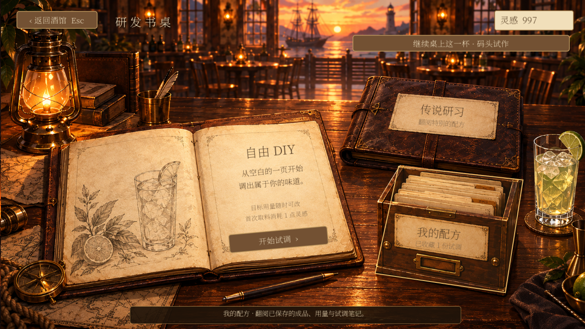
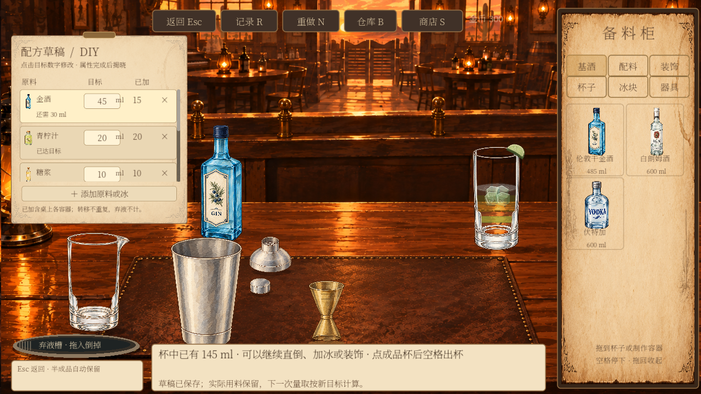
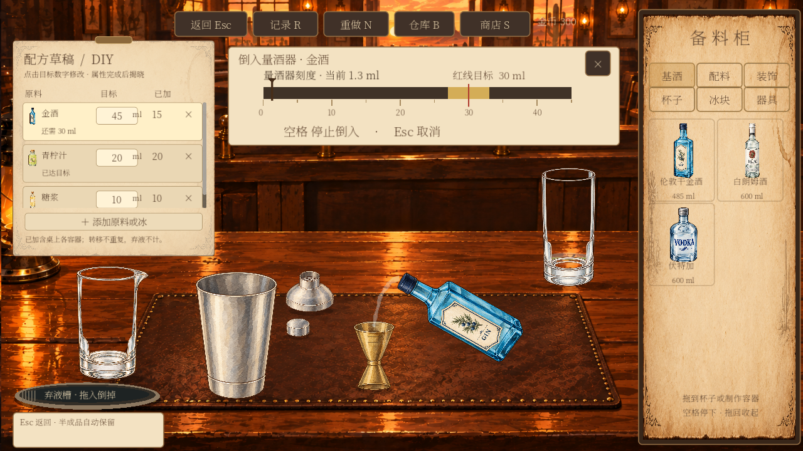
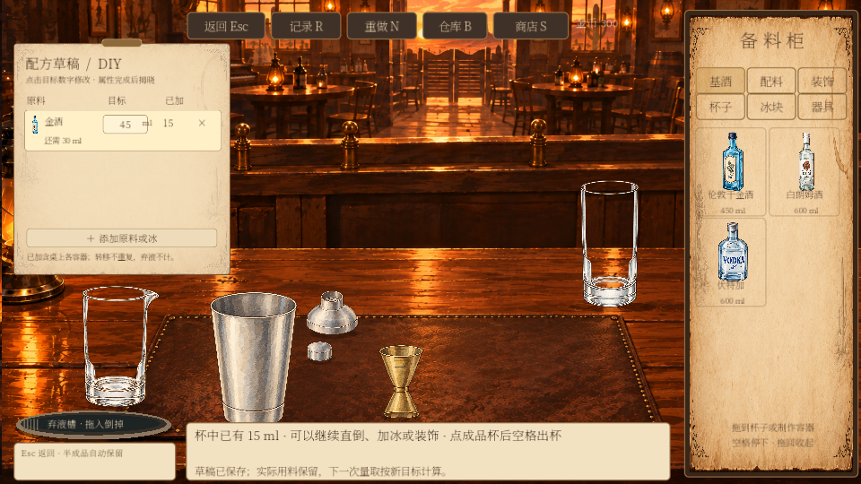

# 研发书桌与可编辑配方草稿

2026-10-04，依据用户选定的「C 入口＋B 配方栏」实现。以下图片为本地 Godot 实际运行截图，使用独立测试存档。

## 入口与操作

主页 → 研发。点击打开的笔记本开始自由 DIY，点击皮质手稿查看传说研习，点击木质配方盒查看已保存配方。鼠标悬停时物件轮廓亮起；支持键盘焦点与返回。已有杯子可从右上角继续，不静默覆盖半成品或已编辑的草稿。



开始试调后，左上角为可编辑的配方卡：

1. 点击「添加原料或冰」，选择液体、固体、装饰或冰型。选择只写计划，不取料、不扣库存或灵感；没有库存的材料也可以先规划，再到商店购买。
2. 点击目标数字输入总用量，按 Enter 或点击别处保存。直接拖瓶前也会提交正在输入的目标，不需要确认弹窗。
3. 「已加」自动记录，不能手工改写。目标下方显示还需、已达目标或超出多少；未经计划的实际材料也会显示为额外加入，可补写目标。
4. 点击 × 只移除目标，不删除实际材料、不退库存。有实际用量的行会继续显示为额外加入。
5. 量取过程中草稿暂不可编辑，停止后可继续调整。填写数字时空格、R 等不会触发制作或记录快捷键。



## 用量与黄金刻度

本次采用一个明确口径：**已加 = 当前桌上所有容器内仍保留的该原料总量**。含量酒器、摇壶、搅拌杯和成品杯；不含已倒掉的材料。它不是累计库存扣除量，也不是已经进入成品杯的量。

因此，量酒器倒入摇壶、搅拌杯倒入成品杯，都不会再次增加「已加」。若倒掉 10 ml，则留存量减少 10 ml、待补量增加 10 ml，但库存不退款。

```text
待补总量 = max(0, 草稿目标 − 桌上留存量)
本次量取目标 = min(待补总量, 60 ml, 量酒器剩余容量, 仓库可用量)
```

60 ml 为沿用的单次推荐上限，不代表量酒器总容量。超过上限分次量取。精确量取保留红色目标线、黄金容差区间和连续实际用量；不会把黄金区间内所有操作强制变成同一个剂量。

例如目标 45 ml、已加 15 ml，下次目标为 30 ml。把目标改为 55 ml 后，下次目标为 40 ml；实际的 15 ml 不变。目标调到低于已加量时提示超量，不会把杯中液体自动删掉，也不会再推荐一整份。

已达目标后，量酒器会提示先增加草稿目标。玩家仍可直接向杯或其他容器自由倒入；直倒没有刻度和目标线，结束后更新实际量。

未设置目标的液体仍可按原有 30 ml 自定量取值开始，玩家可随时补写目标。固体和装饰使用各自的克、块、片、枝等单位，不把它们套入 ml 刻度。冰按现有每份 50 g 加入；方冰每份四块、每块 12.5 g。冰目标只是计划提示，本次没有新增任意克数的冰量取操作。



## 数据与接口

DIY 单杯增加独立字段，官方酒谱仍保持冻结快照：

```json
{
  "draft": {
    "version": 1,
    "revision": 3,
    "targets": { "gin": 45, "lime": 20, "ice:cube": 150 }
  }
}
```

`version` 是草稿格式版本；`revision` 是每次编辑递增的修订号；`targets` 的键使用现有工作台材料 ID，冰使用 `ice:cube` / `ice:crushed`。数量单位来自原料目录，不能由界面随意指定。

编辑仍通过统一命令：

```text
WorkbenchSession.command(command_id, session_id, "edit_draft", {
  "material": "gin", "amount": 45, "remove": false, "revision": 当前修订号
})
```

- 只允许编辑当前正在制作的 `research_diy`。营业和传说目标保持原逻辑。
- 校验材料、数值、计数单位和修订号。过期页面的编辑被拒绝；重复命令仍使用已有回执去重。
- 编辑是规划行为，不产生取料动作、消耗、销售、感官变化或新的单杯记录。
- 草稿和库存、会话一起原子保存。写入失败不发布新草稿，退出恢复不会出现界面目标与存档不一致。
- `draft_amounts(session)` 计算桌上留存；`dose_target(material, session)` 在 DIY 中按剩余目标计算，普通营业保持原算法。
- 从图鉴「以此研发」时，依据参考配方的标准库存用量创建草稿，支持原料别名和冰。旧会话缺少 `draft` 时可从空草稿编辑，不强行改写旧存档。
- 重做新一杯保留目标，实际数量从零开始；返回同一杯保留草稿与实际量。
- 完成时将草稿快照存入 `result.draft`，便于比较意图与结果。保存到图鉴的配方仍按实际成品生成；目标不会替代实际属性，也不会覆盖官方配方。四维数值仍在完成后揭晓。

## 文件归属

| 文件 | 职责 |
| --- | --- |
| `assets/research/research-desk-v1.png` | C 入口书桌背景 |
| `scripts/research.gd` | 真实文字、入口导航、物件标签与继续制作 |
| `scripts/research_desk_hotspot.gd` | 物件多边形点击范围、悬停和键盘焦点反馈 |
| `scripts/research_draft_panel.gd` | B 配方栏、目标输入、实际量与差异提示 |
| `scripts/workbench_session.gd` | 草稿命令、校验、保存、数量口径和剂量目标 |
| `scripts/workbench.gd` | 原料选择、输入提交、量取联动、快捷键隔离 |
| `scripts/workbench_table.gd` | DIY 酒瓶位置避开配方栏，仍最多五款 |

背景通过内置 imagegen 生成，实际界面文字和按钮全部由 Godot 绘制。完整生成提示词及资源说明见 [美术来源](../../assets/research/README.md)。这是固定暖色傍晚书桌；原制作工作台的时间背景同步保持原实现。

## 验证与当前边界

研发集成通过 169 项检查，另一个进程恢复通过 3 项检查，涵盖原生物件点击、草稿输入、修改后直接拖瓶、红线联动、库存与灵感隔离、写入失败、引用配方和重启。检查了正常窗口和 960 × 540 小窗口。

原有工作台原生操作 50 项、容量 134 项、液层 74 项、评价 36 项、库存 44 项、出品 33 项，以及图鉴和酒单目录回归通过。原生工作台旧测试在截图时没有冻结延迟启动的量取计时，本次补齐冻结条件，保持原有 30 ml 精确断言。

已保存配方的原地修订、完整工艺步骤编辑、DIY 营业上架、正式传说内容和 Buff 本次没有扩展。草稿编辑只适用于 DIY；它用于计划与量取指导，不作为经典配方评分目标。测试中仍可见此前记录的退出资源释放警告，未宣称零警告。



## 2026-10-09 更新

DIY可手动上架，收藏页提供名称/笔记修订、历史版本对比与删除（先下架）。新试调可另存新配方或修订原DIY；新制作会话统一感官模型。当前上限为可配置的64份，旧存档超限不删。顾客交付和延后收工已接通；完整流程与事务见[机制实现说明](../客人偏好与酒品评价机制-数据与判定规范-v0.1.md#2026-10-09-实现进度与试玩口径)。
