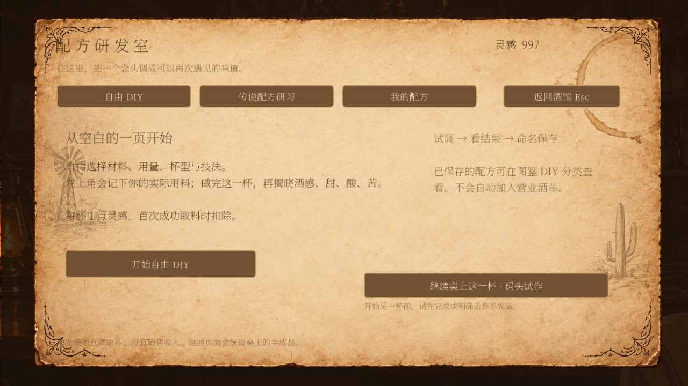
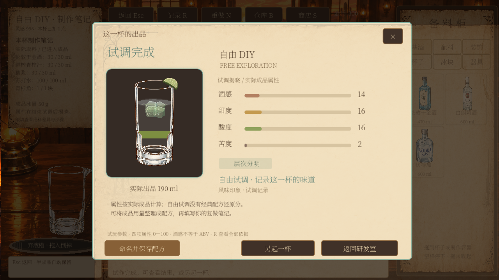

# 研发首版 实现与接入说明

日期：2026-10-04。此文描述已写入 Godot 的首版功能；更完整的客人评分设计仍见上级目录的机制规范，不能将设计文档当作全部已实现。

> 2026-10-04 界面更新：已采用 C 研发书桌＋B 配方栏。操作与数据规则见 [研发界面与配方草稿说明](研发界面与配方草稿-使用和接入说明.md)。下方早期截图保留作为首版记录。

## 如何试玩

1. 正常运行 `project.godot`，点击主页的“研发”。
2. 选择“自由 DIY”，开始试调。灵感初始 999；进入、选杯和加冰不收费，首次成功取用库存原料扣 1 点。
3. 继续在原来的第一视角工作台拖动材料、按空格结束量取、摇和或搅拌。材料仍由仓库提供；缺货可在工作台打开商店补货。
4. 左上角显示可编辑的目标用量，以及自动记录的已加、剩余或超量提示；取料、损耗和操作时长仍在单杯记录中保留，不实时显示酒感、甜、酸、苦。
5. 点成品杯后按空格出杯，结果页显示实际成品预览及四维属性。
6. 命名、填写可选英文名和复做笔记，保存到“我的配方”和图鉴 DIY 分类。保存不重复消耗灵感，不自动上架。
7. 图鉴详情的“以此研发”，或研发室中保存配方的同名按钮，可将这款酒作为下一次自由试调的参考。

正式玩家档案没有免费补充原料；测试脚本使用独立临时库存。灵感 999 是初始化值，不会每次打开页面重置。全局重新开始按原有流程重置库存与工作台，因此也会清空研发记录并重新初始化灵感。

原生 Godot 试玩截图（使用独立测试存档）：





## 已实现

| 功能 | 本版行为 |
| --- | --- |
| 研发准备页 | C 书桌入口：笔记本、传说手稿、配方盒；物件可点击、悬停高亮 |
| 共用工作台 | 不复制调酒操作；复用仓库、容量、分层、冰、装饰、手势和音效 |
| DIY 会话 | 独立模式，不绑定客人、不产生销售收入 |
| 灵感 | 每次 DIY 首次成功取料扣 1 点；普通后续加料、转移、保存、恢复不重复扣 |
| 可编辑配方草稿 | B 配方栏：目标可改；已加为桌上留存，转移不重复；余量驱动量酒器刻度 |
| 完成后揭晓属性 | DIY 没有经典配方还原分，不把自由配比判成经典制作失败 |
| 命名保存 | 中文名、可选英文名、笔记、成品用量、原始试调结果与模型版本 |
| 图鉴 DIY 分类 | 实际成品预览、用料、冰、四维和笔记；不修改经典数据库 |
| 改编起点 | 冻结参考配方 ID、版本与用料；参考用量填入可编辑草稿，不把参考值当作实际属性 |
| 传说状态 | 配方获得记录、研习、完美成功、永久掌握记录；后续失败不清除已掌握状态 |
| 恢复与去重 | 研发记录、灵感与库存使用同一原子存档；同杯不能重复生成多条配方 |

“传说研习”当前显示真实空状态：仓库尚无正式传说配方数据。没有把金汤力或遗言自动改成传说，也没有替用户确定回响与归航的映射。测试中使用仅存在于临时存档的合成配方验证完美与失败流程。

## 消耗与半成品规则

- 成功消耗第一份液体、固体原料或装饰时才扣灵感；拿取杯子、器具和免费冰站的冰不触发收费。
- 库存不足、灵感不足、容器满或存档写入失败时，灵感、库存和容器都保持操作前状态。
- 取消测量的动画预览不扣灵感；成功取料后主动弃液、丢弃或重做不退款。
- 返回研发室保留半成品；继续同一杯不再收费。重做新的一杯，首次成功取料时重新计费。
- 共用一张活动工作台；开始新的研发前，如有已操作的半成品会明确阻止并提示继续或先处理。不会静默覆盖营业半成品。
- 传说研习首版不扣灵感，但真实原料仍消耗。费用配置与 DIY 分开。
- 名称输入框内的空格、R 等作为正常文字输入，不触发工作台快捷操作。

## 保存的是哪些内容

本版保存的是“成品用量＋复做笔记＋原试调记录”。用于配方列表的用量只取成品杯中实际液体、固体、装饰与冰；洒漏、弃液、其他容器余量不会被写成标准入杯用量。完整操作及损耗仍保留在原始结果中，便于以后分析。

参考步骤说明试调使用过的技法，并要求玩家补充顺序与时长；它还不是能自动重放的规范步骤编辑器。复杂的分层倒出、萃取后滤除的材料、溶解和工艺意图仍需后续标准化，不能声称根据成品用量已经还原全部制作过程。因此本版配方标记 `preview_only: true`，暂不开放营业上架。

用料行分开保存显示单位 `unit`（如“块”）和仓库标准单位 `inventory_unit`（如 `piece`）；库存接口使用标准单位，界面使用中文显示单位。

同一杯重复保存会返回已保存的结果，不创建第二条配方。当前支持试调目标用量编辑、新建保存和以此开始新试调；尚未开放已保存配方的原地修订、版本比较、删除及配方数量限制。`version` 预留为正整数，当前新配方从 1 开始。

## 感官数值的实际实现与边界

研发使用 `research-sensory-1`：按成品杯真实液体体积对原料四维贡献加权。固体糖使用明确标为试玩的简单甜度贡献；杯沿装饰不会自动当作果汁。用量以现有液层转移记录为准，留在壶中的原料不影响这杯属性。

研发会话开始时冻结感官配置。改变参考酒谱、改酒名或图片不会改变同一杯的实际属性。结果在完成时保存，打开图鉴不重新计算。原料缺少感官配置时结果标记不完整，不能保存为正常可用配方。

本版没有加入真实 ABV、温度、融水、薄荷萃取、逐口品尝或完整 Buff 授予算法。结果中的“甜味突出”“层次分明”等是感官描述，不是配方奖励或客人满意度。

**营业评价目前仍保留原来的属性锚定与工艺规则。** 研发率先使用独立感官模型，不能把两种模式的分值当成已经完成校准的同一尺度。正式上架之前必须完成标准杯与经典数据对照、公共感官模型校准，以及客人评分规范中的统一迁移。这样避免为赶首版而静默改写莫吉托等已确认数值。

传说研习保留工艺评价器的完美级别，实际属性走研发感官计算。首次完美会记录已掌握；尚未接入传说道具发放、正式上架或剧情奖励。每杯是否授予传说 Buff 应在后续统一 Buff 服务中判断，不能只查看“曾经掌握”。

## 程序接口

新增模式为 `research_diy` 与 `research_legendary`；已有 `practice`、`workbench` 保持兼容。现有 `WorkbenchSession.command(command_id, session_id, kind, payload)` 扩展如下：

| 命令 | 参数 | 条件与效果 |
| --- | --- | --- |
| `begin_research` | `mode`；传说需 `recipe_id`；DIY 可选 `base_recipe_id` | 检查已有半成品与配方权限，冻结模型及参考，开始不扣灵感 |
| `save_research` | `name`、`english_name`、`notes` | 仅当前已完成 DIY；中文名 1—40 字、英文最多 70 字、笔记最多 500 字；按 drink_id 去重 |
| `grant_legendary` | `recipe_id` | 只允许研发配置中已有的正式 ID，供将来的剧情／道具服务调用；当前目录为空则拒绝 |
| `start` | 沿用原有参数 | 重做保持研发模式与配方快照，新会话重置本杯收费标记 |
| 原制作命令 | 沿用原有参数 | 在已有校验、库存与容量规则后，一并提交研发消耗 |

读取接口：`research_state()` 返回独立副本，`research_recipes()` 返回保存记录，`is_research(session)` 判断模式，`research_note(session)` 生成工作台笔记。UI 不直接修改库存、余额或保存记录。

`Navigation.research_view` 用于进入我的配方；`research_base_id` 用于图鉴“以此研发”的一次性路由提示。真正的权限判断与参考快照仍由工作台命令创建，不能只信任界面传来的配方。

## 存档归属

研发数据位于 `Supplies.workbench.research`，随现有库存存档一起保存。它包含 `inspiration`、配方序号、`recipes`、`saved_drinks`、`acquired`、`mastered`。没有另建一份可能与库存不同步的灵感钱包。

单杯额外保存 `mode`、`inspiration_charged`、`inspiration_cost`、`sensory_model`、研发工艺配置快照；改编时附加精简 `base_recipe`；DIY 的 `draft` 独立保存目标用量与修订号。原来的动作、液层、用料、库存扣减与结果结构继续使用。

提交过程先在候选工作台记录扣灵感，再由 `Supplies.commit_workbench` 在同一份候选库存中扣原料，写临时文件并成功替换后才发布状态。写入失败两边均回退。保存配方同样先提交，再更新 UI。研发不调用客人送客、剧情推进或销售收款。

旧存档没有 `research` 字段时按测试初值初始化，下一次正式提交持久化，不迁移旧经典配方。新研发字段经过读取校验，损坏数据保护原文件，不静默重置。

## 文件分工

| 文件 | 职责 |
| --- | --- |
| `data/research.json` | 测试资源参数、正式传说配方目录，目前目录为空 |
| `scripts/research_data.gd` | 研发数据校验、初始状态、独立感官试算与试调结果 |
| `scripts/research.gd`、`scenes/research.tscn` | 研发入口、配方库、传说空状态与选择 |
| `scripts/workbench_session.gd` | 研发会话、原子扣费、保存、获得与掌握记录 |
| `scripts/workbench.gd` | 实际制作笔记、结果入口、命名表单和研发返回 |
| `scripts/workbench_result_card.gd` | DIY 隐藏目标线与经典还原分，完成后展示属性 |
| `scripts/codex.gd`、`scripts/cocktail_detail.gd` | DIY 分类、原杯预览、详情与以此研发 |
| `tests/verify_research.gd`、`tests/run_research.py` | 独立库存下的研发、原生 UI 与重启恢复测试 |

现有酒图生成服务保持独立，本次没有调用外部生成接口，也未修改其代码。当前成品预览直接使用工作台液层、杯型、冰和装饰渲染。图片生成、配方版本和营业上架的后续接入都不能改变已经保存的实际属性。

## 验证与运行

在仓库根目录执行：

```sh
python3 tests/run_research.py --godot /Users/wit/Downloads/Godot.app/Contents/MacOS/Godot --graphics
python3 tests/run_workbench_liquid.py --godot /Users/wit/Downloads/Godot.app/Contents/MacOS/Godot
```

路径应换成各自机器上的 Godot 可执行文件。研发脚本默认使用无头模式；`--graphics` 增加原生页面截图。每次在独立 `/tmp` 目录建立存档，再启动另一个进程验证恢复，不修改玩家真实金币或材料。

本次研发测试通过 169 项断言，新进程恢复通过 3 项断言；原生图形模式已检查入口、制作、结果、命名、配方库、图鉴详情及小窗口。

覆盖：首次收费、库存不足、灵感不足、写入失败回滚、重复命令、同杯重复保存、成品与损耗分离、参考配方不影响实际属性、传说完美／失败、图鉴 DIY、中文与英文命名输入、营业半成品保护和新进程恢复。

兼容回归包括原液层 74 项、工艺评价 36 项、库存 44 项、出品 33 项、容量 134 项，以及原图鉴交互、经典数据库和酒单目录测试。部分无头测试仍输出已有的退出资源未释放提示，未将其描述为零警告。

## 后续接入顺序

1. 对齐统一感官模型与经典标准杯，补齐缺失的单位和原料数据。
2. 加入结构化配方草稿编辑，明确顺序、技法、冰与分层意图；支持修改已有配方版本。
3. 将正式传说内容与剧情道具接入获得接口，连接掌握后的正式酒单可用状态。
4. 接入公共 Buff 判定、客人评价与 DIY 酒单桥接；保存仍不自动上架。
5. 接入独立图片生成客户端；图片失败不影响已保存的配方与原杯预览。
