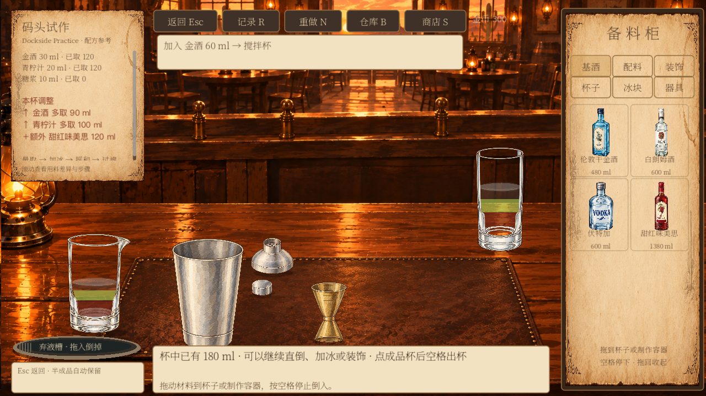
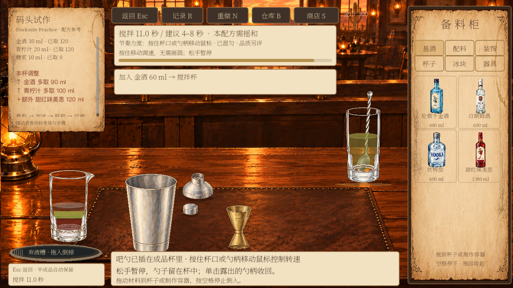

# 酒液分层与调色系统交接说明

《致未归的客人》工作台 · v0.10.0 · 2026 年 10 月 3 日

面向策划、美术与程序。本次在现有 Godot 工作台中实现统一液体外观、顺序分层、渐进混合和分层倒出，并接入现有库存、容量、存档和出品评价。本文中的颜色、混合速度与阈值均为试玩参数，尚未作为美术或平衡定稿。

## 本次实现的玩家体验

- 连续加入不同原料时，先加入的在下、后加入的在上。相邻且配比一致的液体会合并为一层；相同颜色不一定代表相同原料。
- 搅拌或摇和会逐渐交换各层中的原料，让颜色逐渐接近。实际操作的时长和力度影响融合速度，停手后不继续混合；原有液面波纹可以继续播放。
- 完全混匀后收为一层，再加新原料只在上方形成新层，原来的混合液不会拆回各原料。
- 倒出时先倒上层。目标杯装满后停止，剩余液层与原料留在源容器中。混匀的一层按其内部配比倒出。
- 滤冰只保留原有规则下的冰与固体，不会把分层液体自动混匀。左下角弃液槽清空指定容器，同时记录浪费，不退回库存。
- 高球杯与搅拌杯内的液体按杯壁形状裁切。流出的酒液按当前正在倒出的液层显示颜色；量酒器口部显示上层颜色。
- 制作提示显示“分层明显”“正在融合”或“已混匀”。混匀程度与品质评分分开，仍需满足酒谱的技法、时长、配料等要求。
- 成品弹窗读取这杯酒保存的实际液层和外观配置，继续使用现有品质高光边。

摇壶与量酒器内部同样记录液层，但金属外壁不做透明透视。玻璃杯、搅拌杯和成品预览承担主要的分层展示。

## 实际画面

以下为原生 Godot 测试画面。用于对比的配比是甜红味美思、青柠汁、金酒各 60 ml，不是新增的标准酒谱；左侧搅拌杯保持未混合，右侧高球杯接受搅拌。



图 1　两只玻璃容器都保留加入顺序形成的液层。



图 2　右侧高球杯混为一色，左侧搅拌杯仍保留原来的分层。阶段截图与成品弹窗截图保存在同目录。

## 调色规则与配置

### 原料配置

统一来源为 `data/supplies/catalog.json` 中液体商品的 `liquid_appearance` 字段，目前覆盖全部 16 种以 ml 计量的原料。配方和库存仍使用原有商品编号；历史简写如 `gin`、`lime` 会映射到对应 SKU（商品唯一编号）。美术只需维护同一份原料外观配置。

| 字段 | 含义 | 目前约定 |
| --- | --- | --- |
| version | 外观配置版本 | `appearance-playtest-1` |
| rgb | 原料的基础色 | 三个 0–255 数值，按 sRGB 填写 |
| strength | 对混合颜色的贡献强度 | 0 表示无色；可以大于 1，苦精试玩值为 3 |
| turbidity | 浑浊程度 | 0–1；与颜色、酒精度分别配置 |

例如，青柠汁当前配置为：

```json
"liquid_appearance": {
  "version": "appearance-playtest-1",
  "rgb": [164, 202, 66],
  "strength": 0.65,
  "turbidity": 0.65
}
```

金酒、白朗姆、伏特加、苏打水、汤力水和简单糖浆等当前按无色液体配置；这是本版素材表现约定，不代表所有品牌或类别都没有颜色。新增液体必须补充此字段；未配置的液体会以洋红色作为开发排错标记。

### 如何合成一层酒液的颜色

1. 将各原料 sRGB 转换为线性 RGB，再做加权平均，避免直接平均屏幕 RGB。
2. 每种原料的颜色权重为“实际毫升数 × strength”。按权重合成色相，并计算整层的平均着色强度。
3. 浑浊度单独按实际体积加权。渲染时，着色强度与浑浊度共同决定不透明程度，并叠加少量浑浊散射效果。
4. 玻璃反光、液面高光、杯内明暗和场景背景参与最终观感，不写回原料颜色。

例如 30 ml 青柠汁加入 90 ml 无色苏打水后，平均着色强度降为原来的四分之一，浑浊度也被稀释。无色材料不会作为白色颜料把酒调成白色；清澈液体保留轻微可见度，便于在游戏中判断液位。

这是一套可调的美术近似算法，不是光谱、化学反应或真实液体物理模拟。RGB 加权也不等于所有现实酒液的真实混色结果；需由美术在白天、黄昏、夜晚背景下继续校色。

### 混合参数

`data/workbench/liquid.json` 集中保存模型版本和混合参数，新制作会话取得一份快照。

| 参数 | 本版值 | 作用 |
| --- | --- | --- |
| version | `layers-v1` | 液层数据与混合规则版本 |
| stir_rate | 0.8 | 有效搅拌的融合速度系数 |
| shake_rate | 1.4 | 有效摇和的融合速度系数 |
| uniform_tolerance | 0.015 | 各层配比接近整杯配比时合并为一层的阈值 |

每次有效动作的融合比例为 `1 - exp(-速度系数 × 秒数 × 力度)`。各层保留自己的体积，并将其部分组成朝整杯平均配比靠近，因此混合不会凭空增加或减少任何原料。所有液层与整杯的配比差距都达到阈值后，合并为一层。力度为 0 时不混合。

这些系数控制“看起来混匀”的速度。品质评价仍使用 `data/workbench/evaluation.json` 中的独立技法和时间规则，因此不能把“已混匀”当成“完美出品”。改动 JSON 后需重启游戏读取配置，并新开一杯观察新参数；已有杯使用自己的配置快照。

## 数量守恒与倒出示例

搅拌杯依次加入 90 ml 金酒、90 ml 青柠汁，不搅拌，向空的 120 ml 成品杯过滤。新规则先倒出上层 90 ml 青柠汁，再倒出 30 ml 金酒；源容器保留 60 ml 金酒。接收杯从下到上是青柠汁、金酒，因为接收杯按流入先后重新叠层。

如果先充分混匀再倒出 120 ml，出杯会包含各 60 ml，源容器剩各 30 ml。两种操作的实际出品配比不同，评价与属性也应以真正入杯的原料计算。

每个容器的所有液层相加必须等于其 `contents` 总量。所有容器余量加已弃液量，应与本次取料量保持一致。容器之间转移不扣第二次库存；只有从备料库取出材料时实际扣料。重复命令沿用现有编号去重，落盘失败不会提交半套库存或液层变化。

当前延续原有容量规则：标准方冰一份 50 g，共 4 块，每块 12.5 g；试玩占位按 50 ml 处理。直接转移可带走整块冰，过滤保留冰。旧存档的 40 g 冰批次按旧数量保留，本次不重写它们。尚未将融水加入液体总量。

## 数据与程序接入

### 需要区分的数据

| 数据 | 放在哪里 | 读写职责 |
| --- | --- | --- |
| 原料外观定义 | 原料商品目录 | 美术与配置维护；新会话读取 |
| 混合规则定义 | `data/workbench/liquid.json` | 程序与策划调整；新会话读取 |
| 配置快照 | 会话的 `liquid_profiles`、`liquid_model` | 开始制作时冻结；退出恢复继续使用 |
| 实际液层 | 容器的 `layers` | 仅制作命令修改；底层在前、顶层在后 |
| 原料总量 | 容器的 `contents` | 由液层重新汇总，兼容原有库存、容量与评价接口 |
| 动作中的实际倒出 | `action.pour.contents`、`action.pour.layers` | 记录实际组成及流出顺序；供评价追踪与倒酒动画使用 |
| 成品外观 | `result.contents.layers` 和结果配置快照 | 成品预览只读；不覆盖官方配方 |

容器中的简化数据示例：

```json
{
  "contents": {"gin": 40, "lime": 20},
  "layers": [
    {"contents": {"gin": 40}},
    {"contents": {"lime": 20}}
  ]
}
```

对外维护原料仍以 SKU 为准。上述 `gin`、`lime` 是工作台已有的内部兼容名，不应另建第二份原料资料。

### 文件职责

- `scripts/workbench_liquid_state.gd`：纯数据操作；处理新增、混合、取出、液层汇总和守恒校验，不接触库存或页面。
- `scripts/workbench_liquid_appearance.gd`：读取统一原料外观，处理 SKU 别名、线性 RGB 加权、浑浊与不透明度。
- `scripts/workbench_session.gd`：接收操作、计算容量、扣料和原子存档；把液层变化纳入制作会话，冻结成品数据。
- `scripts/workbench_liquid.gd`：杯壁裁切、分层填充、液面和流动效果；显示插值不修改真实毫升数。
- `scripts/workbench_table.gd`、`scripts/workbench_drink_preview.gd`：工作台与结果弹窗使用同一套液体显示逻辑。
- `scripts/workbench_evaluation.gd`：按实际转移的液层追踪用料和制作经历；旧动作仍使用旧版按比例转移的解释。

外部页面继续通过 `WorkbenchSession.command` 发起正式取料、搅拌、转移和结束命令，读取 `snapshot()` 获得界面数据。不要直接改 `contents` 或 `layers`，也不要在界面里再次扣库存。`withdraw` 新记录带有 `liquid_layered` 标记；混合动作记录使用的 `liquid_model`，使评价能够复现对应液层流转。

### 存档兼容边界

有液层的新存档恢复液层、配比、配置快照和剩余数量。只有总量的旧容器按“一层已混合的液体”读取，下次正式操作时补齐字段；不会凭空猜测旧杯子的加入顺序。

旧成品如果没有保存外观配置，只能使用当前配置显示，无法还原过去未保存的颜色。新成品会冻结配置与层数据；将来如果改变调色算法本身，仍需增加版本分派或迁移，不应仅改版本字符串就假设历史显示完全一致。未知液层模型版本会被校验拒绝，应先编写明确迁移规则。

## DIY 研发如何复用

本次交付的是共用底层与现有工作台接入，尚未新增完整 DIY 研发页面、命名保存流程或上架流程。

建议后续研发界面沿用“选择基础配方或新建 → 共用工作台试调 → 查看结果 → 命名保存 → 自行上架”。正式试调继续通过会话命令扣料；仅用于预览的临时杯可在独立字典上调用 `LiquidState.add`、`mix`、`take`，配合 `LiquidAppearance.sample` 和 `Liquid.draw`，不碰库存。

接入时还需完成以下任务：

1. 扩展会话模式校验及研发资源规则，明确试调、教学与营业各自的消耗和结算。目前正式会话模式仍保留已有 `practice/workbench` 约定。
2. 保存“可复现配方草稿”：原料和剂量、加入顺序、技法、冰、杯型、装饰，并明确目标是均匀酒还是分层酒。目标呈现字段与分层评价尚未加入正式酒谱结构。
3. 区分试调单杯记录与可复现酒谱。实际洒漏、丢弃等仍属于这一杯；不能把全部动作日志直接当成新标准酒谱。
4. 增加双语名称、备注、另存为新配方与修订版本，并保存配方引用及必要的外观版本。图鉴预览复用液体模型；保存后不自动上架。
5. 为灵感费用、次数、配方数量及允许修改范围保留独立配置，具体数值另定。传说配方道具解锁保持独立。

## 验证结果与复查方法

本次新增两组测试，并调整旧容量测试：需要验证“混匀后按比例倒出”的样例现在先执行搅拌，而不是默认所有液体天然混匀。

| 检查组 | 通过数 | 覆盖重点 |
| --- | --- | --- |
| 液层与调色逻辑 | 74 | 16 种液体配置、别名、稀释、渐进混合、顶层倒出、去重、快照、迁移、弃液；含固定随机种子的 300 步守恒检查 |
| 原生工作台画面 | 36 | 双杯分层、阶段混合、提示布局、成品快照与截图 |
| 新进程恢复 | 4 | 混匀成品与未混合容器同时恢复，库存不变 |
| 杯型与容量回归 | 134 + 3 | 五款标准酒容量、部分转移、整块冰、弃液、失败写入及新进程恢复 |
| 原有评价、库存、出品回归 | 36 + 44 + 33 | 品质与仓库接口继续工作 |

合计 364 项断言通过。测试使用独立 `/tmp` 存档，未修改玩家真实库存与存档。原生图形测试没有脚本或渲染报错；部分无头测试退出时仍有既有的 ObjectDB/资源未释放提示，这属于待清理的退出资源问题，不计为零日志警告。

程序同事可在项目根目录运行 `python3 tests/run_workbench_liquid.py --godot /实际路径/Godot --graphics`。此脚本自动建立独立临时存档并运行核心回归、原生界面与重启恢复检查。容量专项需单独运行。

新增入口为 `tests/verify_workbench_liquid.tscn` 与 `tests/verify_workbench_liquid_visual.tscn`。运行需使用独立的 `--slot-wallet`、`--dialogue-save`、`--game-save`、`--menu-save`、`--supplies-save`、`--workbench-save`、`--audio-settings` 路径；测试基类会拒绝使用玩家目录。图形组需用原生窗口运行；使用同一组临时路径加 `--liquid-resume` 可检查另一个进程的恢复。

人工试玩可按以下顺序复查：在高球杯依次加入不同色原料；观察分层；拖入吧勺并短暂搅拌、停手，再继续到混匀；加入一份新原料检查新顶层；通过容器向较小杯倒出，确认杯满后有余量；退出再进入；最后出杯核对弹窗。

## 后续改进建议

- **美术校色与参数面板**：由美术统一审核 16 种液体的基础色、着色强度、浑浊度，并制作可并排对比昼夜背景的配置预览工具。目前编辑配置仍通过 JSON，没有新增可视化后台。
- **液层边界和混合动效**：增加柔和边界、局部旋涡、泡沫和细小气泡；当前主要通过液层颜色渐近和原有液面波纹表达混合。
- **物理近似**：按需加入密度、倒入冲击和自然扩散。当前分层完全按加入顺序，不计算真实稳定性，混匀后也不会自然重新分层。
- **冰与原料萃取**：建立融水、温度、果汁释放和薄荷轻压的定量规则后，再把新增液体及色素接入模型。现阶段冰占位、固体和装饰保持独立，不凭空生成融水或绿色染色。
- **研发专属目标与评价**：支持均匀／分层呈现目标、图鉴 DIY 保存与版本修订，补充按目标呈现评价的规则，避免把刻意分层统一当作制作失败。
- **性能与版本维护**：大量微量交替加料可能形成较多液层；后续评估显示合并上限及长期存档体积。调色算法升级需补充历史版本回放与迁移测试。

建议先完成美术校色与 DIY 研发保存流程，再逐步加入密度、融水等复杂规则；这些后续项尚未计入本次实现。
