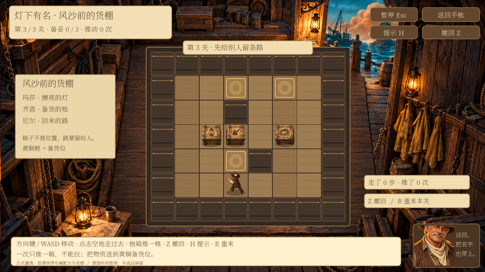
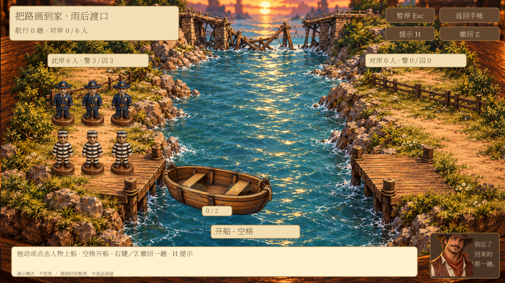
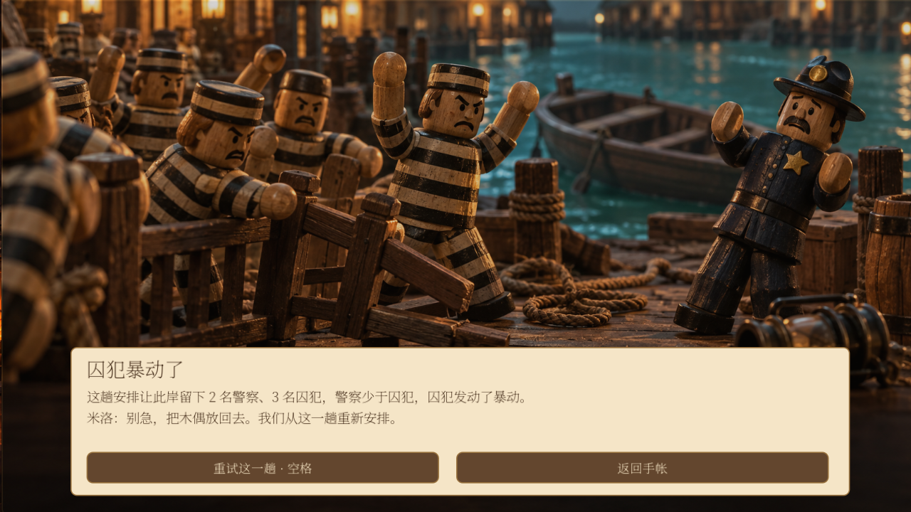

# 角色小游戏 v0.3：推箱子与警囚渡河

2026-10-09。此文描述已经接入 Godot 的功能；旧 B 方案中的扩展建议不等于全部实现。

## 老霍克：灯下有名 · 风沙前的货棚

已替换原三路移灯玩法。玩家控制货棚模型里的老霍克，把灯、油、绳货箱推到黄铜目标格。三关分别有 1、2、3 只箱子；任何箱子都能放任何目标格。一次只能推一箱，不能拉箱、穿墙、连续推两箱。不设倒计时，也不消耗酒馆物资。

| 操作 | 实际行为 |
| --- | --- |
| 方向键 / WASD | 走一格或推动前方一只箱子；移动带短动画 |
| 点击空地 | 寻找不穿过箱子的路径，逐步走过去 |
| 朝一个方向拖箱子 | 人物先走到发力侧，再推一格；到不了箱后则提示 |
| Z / 右键 / 撤回按钮 | 撤销一次合法动作，恢复人物与货箱 |
| H | 根据当前盘面搜索下一步；明显死角提示撤回或重来 |
| R | 确认后重置当前关，保留前面关卡 |
| 空格 | 当前关全部入位后继续，第三关后进入结算 |
| Esc | 暂停，可继续或返回手帐 |

点地走路和拖箱的排队动作会被新的键盘操作打断；暂停、撤回、重置会清掉队列。逻辑先保存，再播放动画；存档失败时人物和箱子不移动。退出时恢复的是最后一格已保存状态，不保存半格动画。

画面：暖色港口货棚、木地板与墙梁、三种箱子、老霍克模型、入位高光。声音：木地板脚步、木箱接触声，灯箱金属声、油箱液体声、绳箱纤维摩擦声；入位提示音与完成音。现有素材先用于建立差异，后续可换成专录的木箱滑动与麻绳声音。

每关后显示一段旧事：玛莎备灯、齐恩物资账、尼尔·贝克认路。第五章收尾已加入货棚复盘邀请，原来的口味线索和对话节点 ID 保留。

## 米洛：三名警察与三名囚犯

开场、第五章邀请、手帐描述、提示、结果、木偶和失败 CG 已统一成警察与囚犯。小船一次载 1–2 人，不能空船，任何人都能划船。

**每一岸分别检查：有警察时，囚犯人数大于警察人数会暴动；无警察的一岸可以暂留囚犯。** 这是经典题保持可解的规则。若连零警察的岸也一律判失败，两座船便无法完成三对三渡河。船本身不额外添加人数约束。

例如开局只运走 1 名警察，出发岸剩 2 名警察、3 名囚犯，会触发暴动。失败不是禁止开船：先播放航行，再进入暴动 CG，说明是哪一岸、各有几人。按空格重试这一趟，回到最后一次安全局面；已完成的安全航程保留。空船和超载仍直接提示。

失败 CG 是示意演出，背景木偶数量不作为规则计数；文字中的人数来自本次实际安排。失败过程不写入非法盘面，不发奖励。标准解法已验证可在 11 趟内完成。

## 接口与存档

- 老霍克保留 `hank_lantern` ID、手帐角色关联、解锁条件和 `character_hank` 奖励配方，避免旧存档失联。新玩法状态 `model=2`；中文展示名已更新。
- 推箱状态包含关卡、人物格、箱子格、当前关动作记录、前关完成记录、步数、推动数、提示次数和完成标记。
- `hank_crate_rules.gd` 负责纯规则、寻路、提示与校验；`hank_crate_board.gd` 负责绘制与鼠标输入；控制页转交 `GuestActivities` 保存和结算。
- 读取时重放每关动作，验证当前位置与前关完成记录，不能只修改 `won` 就领奖。
- 未完成的旧移灯局会转为推箱第一关，并显示说明；邀请和已领首通奖励保留。旧版已通关但尚未领的奖励可直接补领。
- 正式模式沿用“故事 5 章 + 2 次满意招待”邀请条件，首通配方与 3 点灵感只发一次。演示模式不推进剧情、不领奖。
- 游戏期间暂停酒馆时间；调酒半成品、材料库存和金币不因小游戏改变。

## 验证与试玩

使用独立 `/tmp` 存档测试，没有写入玩家正式存档。

- 三角色完整流程：294 项通过，包括键盘/鼠标操作、三关推箱、暴动 CG、失败重试、剧情口味线索、首通奖励、重复领取、旧存档迁移与写入失败回滚。
- 新进程恢复：10 项通过，包括推箱第二关的位置、历史记录和三角色奖励。
- 推箱纯规则：105 项通过，包括全关卡解法、墙和双箱碰撞、撤回、JSON 还原、伪造完成记录拒绝。
- 艾达机芯规则回归：180 项通过；转速独立回归 8 项通过。
- 测试进程退出仍有既有资源清理告警；未出现本轮游戏中的脚本解析或运行错误。

从 **手帐 → 老霍克 / 米洛 → 小游戏 → 开始游戏** 进入。演示入口沿用当前开发配置。也可执行 `python3 tools/play_character_activities.py --activity hank_lantern` 打开独立试玩存档；米洛使用 `--activity milo_ferry`。

## 后续可调整

第三关难度、箱子和人物的大小、推箱动画力度、音效响度可按试玩反馈微调。当前 H 提示给下一步方向，尚未制作多层提示插画。死角提示识别墙角，不承诺检测所有组合死局；撤回与重来始终可用。货棚盘面是清晰的二维格子，可继续细化木纹、墙体阴影和专用推动动作；不需要改变已验证的规则接口。
