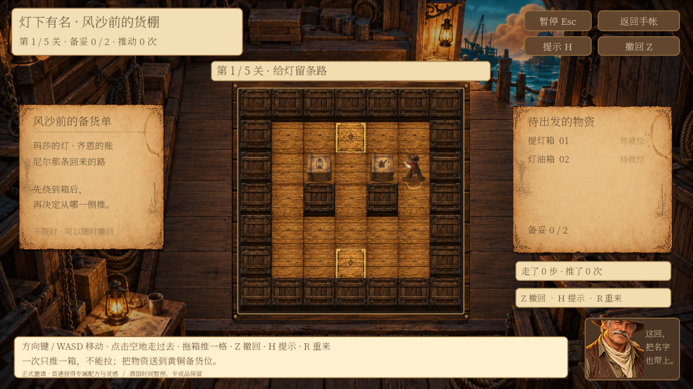
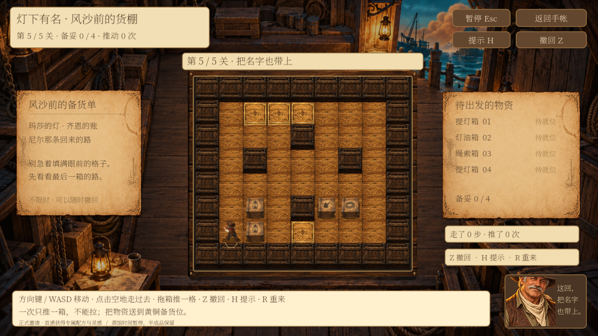

# 角色小游戏：老霍克 v0.4 与警囚渡河

更新于 2026-10-10。老霍克已升级为五关版；米洛维持 v0.3。此文描述已接入 Godot 的功能。

## 老霍克：灯下有名 · 风沙前的货棚

已替换原三路移灯玩法。玩家控制货棚模型里的老霍克，把灯、油、绳货箱推到黄铜目标格。新版五关分别有 2、3、3、4、4 只箱子；任何箱子都能放任何目标格。一次只能推一箱，不能拉箱、穿墙、连续推两箱。不设倒计时，也不消耗酒馆物资。

| 操作 | 实际行为 |
| --- | --- |
| 方向键 / WASD | 走一格或推动前方一只箱子；移动带短动画 |
| 点击空地 | 寻找不穿过箱子的路径，逐步走过去 |
| 朝一个方向拖箱子 | 人物先走到发力侧，再推一格；到不了箱后则提示 |
| Z / 右键 / 撤回按钮 | 撤销一次合法动作，恢复人物与货箱 |
| H | 根据当前盘面搜索下一步；明显死角提示撤回或重来 |
| R | 确认后重置当前关，保留前面关卡 |
| 自动过关 | 最后一箱落位动画结束后弹出老霍克的对白，停留约 5–8 秒后自动进入下一关；最后一关自动结算。旧版三关同样支持 |
| Esc | 暂停，可继续或返回手帐 |

点地走路和拖箱的排队动作会被新的键盘操作打断；暂停、撤回、重置会清掉队列。逻辑先保存，再播放动画；存档失败时人物和箱子不移动。退出时恢复的是最后一格已保存状态，不保存半格动画。

画面：暖色港口货棚、木地板与墙梁、三种箱子、老霍克模型、入位高光。声音：木地板脚步、木箱接触声，灯箱金属声、油箱液体声、绳箱纤维摩擦声；入位提示音与完成音。现有素材先用于建立差异，后续可换成专录的木箱滑动与麻绳声音。

每关完成后自动弹出一段旧事：玛莎备灯、齐恩物资账、车夫认路、回头接人、清单上的位置。对白停留时间随文字长度调整；切出游戏窗口时暂停倒计时。弹窗期间屏蔽移动和撤回，避免长按误操作。下一关仍通过原有保存接口进入，若保存失败则保留已完成关卡，显示重试保存入口。第三章收尾已加入货棚复盘邀请，第五章再揭晓车夫姓名并呼应清单，原来的口味线索和对话节点 ID 保留。

### 五关设计与难度

| 关卡 | 箱数 | 已验证解法的推动次数 | 主要练习 |
| --- | --- | --- | --- |
| 给灯留条路 | 2 | 6 | 绕到正确的发力侧 |
| 账房的窄门 | 3 | 9 | 腾出狭窄通道 |
| 先放下，再出发 | 3 | 12 | 暂放与重新接近箱子 |
| 回头的余地 | 4 | 16 | 留出回头路，安排搬运次序 |
| 把名字也带上 | 4 | 20 | 同时安排多个箱子的路线 |

上表是已验证解法的推动次数，不是通关限制，也不宣称全局最优。每关所有合法动作都经过存档回放验证。允许无限撤回和重来，不用倒计时制造难度。

### 美术与手感

- 棋盘使用新增的手绘木纹、深色横梁货箱墙和黄铜备货位，外框增加厚度、钉头与阴影。
- 左侧纸页展示旧事和搬运建议，右侧清单逐箱显示是否备妥，下方显示步数与推动数。
- 人物行走与推动速度区分；箱子推动带轻微倾斜、落地阴影、尘屑，落位带短暂金色光圈、火星与对勾。
- 鼠标悬停标出可走格，拖箱显示方向，提示箭头显示下一步。换关、撤回、重置和再玩一局会清理上一状态的反馈。
- 保留木脚步、推箱摩擦、金属、油液和绳索差异音效，入位有独立提示音。
- 本轮使用内置 image_gen 生成地形纹理图集；原有角色、货箱与货棚背景继续使用。图集与完整生成提示见 [hank-tiles.png](../../assets/activities/v4/hank-tiles.png) 和 [generation.json](../../assets/activities/v4/generation.json)。

### 提示与卡死处理

H 根据当前局面给出一个可执行方向。预设解法前缀可以立即提示；玩家走出其他路线后，搜索按约 3.5 毫秒的时间片分帧继续，玩家移动会取消过期提示。搜索的是推动状态，并合并人物能走到的同一区域。

反向可达分析会识别箱子无法再被推回任何目标的格子，给出撤回建议。复杂组合局面仍可能达到搜索上限，此时只说明暂时未找到提示，不把搜索超限误判成无解。提示不替玩家移动，不改变已保存的盘面。

## 米洛：三名警察与三名囚犯

开场、第二章邀请、手帐描述、提示、结果、木偶和失败 CG 已统一成警察与囚犯。小船一次载 1–2 人，不能空船，任何人都能划船。

**每一岸分别检查：有警察时，囚犯人数大于警察人数会暴动；无警察的一岸可以暂留囚犯。** 这是经典题保持可解的规则。若连零警察的岸也一律判失败，两座船便无法完成三对三渡河。船本身不额外添加人数约束。

例如开局只运走 1 名警察，出发岸剩 2 名警察、3 名囚犯，会触发暴动。失败不是禁止开船：先播放航行，再进入暴动 CG，说明是哪一岸、各有几人。按空格重试这一趟，回到最后一次安全局面；已完成的安全航程保留。空船和超载仍直接提示。

失败 CG 是示意演出，背景木偶数量不作为规则计数；文字中的人数来自本次实际安排。失败过程不写入非法盘面，不发奖励。标准解法已验证可在 11 趟内完成。

## 接口与存档

- 老霍克保留 `hank_lantern` ID、手帐角色关联和 `character_hank` 奖励配方，避免旧存档失联。新玩法状态 `model=2`；中文展示名已更新。
- 推箱状态包含关卡、人物格、箱子格、当前关动作记录、前关完成记录、步数、推动数、提示次数和完成标记。新增 `layout_version=2` 表示五关布局；缺少该字段按旧版三关布局读取。
- 已经开始的旧版三关继续使用原地图和动作记录，并显示说明；本局完成后再开新局才进入五关版。布局版本与状态模型分开，不把旧解法套到新地图。
- `hank_crate_rules.gd` 负责纯规则、寻路、提示与校验；`hank_crate_board.gd` 负责绘制与鼠标输入；控制页转交 `GuestActivities` 保存和结算。
- 读取时重放每关动作，验证当前位置与前关完成记录，不能只修改 `won` 就领奖。
- 未完成的旧移灯局会转为推箱第一关，并显示说明；邀请和已领首通奖励保留。旧版已通关但尚未领的奖励可直接补领。
- 正式邀请现在分别配置：米洛完成第 2 轮剧情、老霍克完成第 3 轮剧情，不再额外要求满意招待；艾达仍为第 5 轮剧情 + 2 次满意招待。每个小游戏的首通配方与 3 点灵感只发一次。演示模式不推进剧情、不领奖。详见《人物剧情与小游戏解锁节奏.md》。
- 游戏期间暂停酒馆时间；调酒半成品、材料库存和金币不因小游戏改变。

## 验证与试玩

使用独立 `/tmp` 存档测试，没有写入玩家正式存档。

本轮验证：

- 推箱纯规则：613 项通过，包括五关完整解法、所有中间动作的 JSON 存档回放、撤回、碰撞、旧版三关兼容、伪造记录拒绝、非预设路线分帧提示。
- 三角色无窗口完整回归：309 项通过；新进程恢复：10 项通过，覆盖进度、首通奖励与重复领取等接口。
- 实际图形窗口回归：319 项通过，新进程恢复 10 项通过，包含键盘、鼠标拖箱、暂停与五关流程；随后的小改动另通过上述最终无窗口和规则检查。
- 测试进程退出仍有既有的资源清理告警；本轮未出现脚本解析错误或游戏中的运行错误。

从 **手帐 → 老霍克 / 米洛 → 小游戏 → 开始游戏** 进入。演示入口沿用当前开发配置。也可执行 `python3 tools/play_character_activities.py --activity hank_lantern` 打开独立试玩存档；米洛使用 `--activity milo_ferry`。

## 后续可调整

五关难度与时间仍需真人试玩反馈，推动次数只是可解证明的一部分。后续可以添加多层故事提示、专门绘制更高分辨率的角色与货箱动作、专录木箱摩擦音效，以及可选的少推挑战。目前不增加计时惩罚，也不以步数限制正式奖励；先保证解谜、撤回与存档衔接稳定。

### 自动过关补充验证

无窗口流程检查 359 项、跨进程恢复 10 项通过；覆盖每关自动弹窗、弹窗期间的输入隔离、窗口失焦时停留、自动进入下一关与最终结算。
