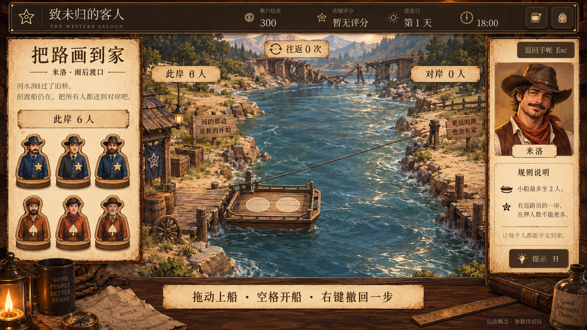
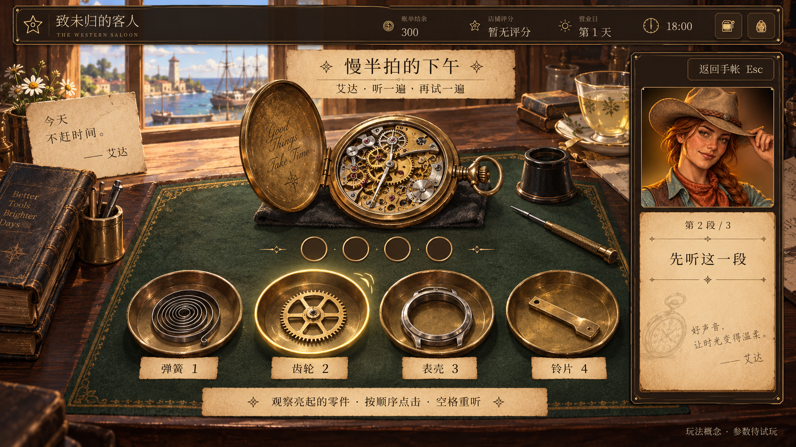
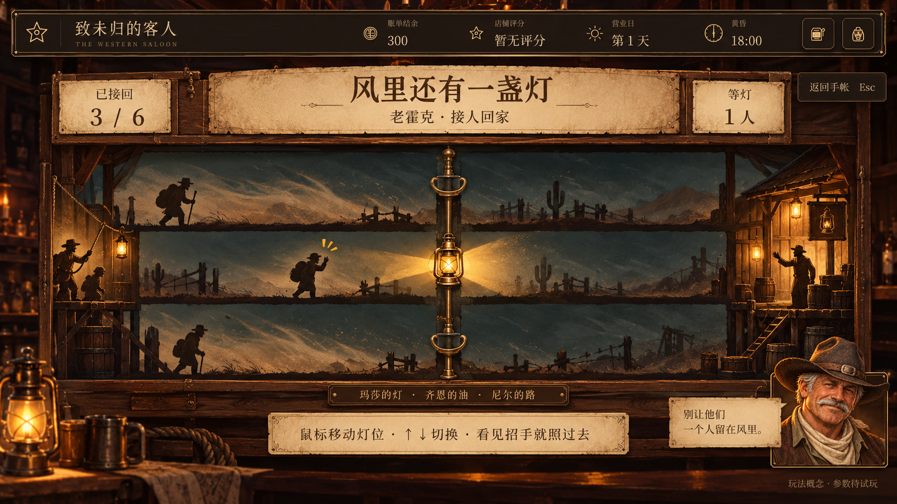

# 《致未归的客人》角色故事、口味变化与专属小游戏设计

版本：v0.1 · 2026-10-09 · 供策划、剧情、美术和程序共同讨论  
范围：米洛、艾达、老霍克；小线作为设计和技术参照；本稿不展开黄色生物。  
最新调整：根据本轮反馈，**米洛改为经典“三人与三人、小船过河”谜题**，原画路线方案不再作为本稿主方案。

> **阅读约定**：标为“现有”的内容来自当前项目；人物五章主线继续沿用。章节里的新增场景、台词、口味事件、专属酒、小游戏、奖励与解锁规则均为“建议”。全部新数值是试玩起点。本次交付是设计文档与概念图，尚未把新机制写入游戏代码或正式配置。

阅读建议：看人物和画面先读第 3～5 节；看酒与解锁读第 6～7 节；程序接入与任务拆分读第 8～10 节。主线文本与新增建议分开，避免把讨论稿直接当作已经入库的剧情。

## 1. 我希望玩家最终记住什么

玩家先记住一个人的点单方式，随后听懂他今天为什么点得不同，最后获得一次一起做事的邀请。调酒负责“我听见你今天想要什么”；故事负责让人物在酒馆之外行动；小游戏让玩家亲手参与一件与这个人有关的小事。

酒不会解决地图错误、替艾达完成排班、替老霍克找回所有姓名。角色仍然需要自己承担决定。玩家的作用是接待、倾听、记住，并在被邀请时陪他们完成一件事。

| 角色 | 表面的愿望 | 更深的矛盾 | 最后能够做到的事 | 专属小游戏与玩家动作 |
| --- | --- | --- | --- | --- |
| 米洛 | 成为值得讲述的旅行者 | 想让地图漂亮、名字显眼，容易忽略真正使用地图的人 | 愿意承认未知，把路线写到别人能用，也真的安排一次回家 | **把路画到家·雨后渡口**：安排六人乘两人小船往返，复核渡口方案 |
| 艾达 | 把所有事及时做好 | 把“别人需要我”当作自己的价值；自己的兴趣永远排最后 | 让同伴承担责任，给自己留下一段修表的下午 | **慢半拍的下午**：听声音、记住零件次序，陪她完成修表练习 |
| 老霍克 | 把那场风沙的往事说准确 | 怀念被当作英雄的滋味，又知道许多人的贡献被省略了 | 接受自己也会迷路，让别人的名字进入共同记忆 | **风里还有一盏灯**：在三个位置之间移灯，配合同伴接人回来 |
| 小线，参照 | 再有人愿意陪自己玩 | 过去的游戏被遗忘，自己也不知还有没有位置 | 从“讲旧游戏”变为“现在有人和我一起玩” | 现有羽毛球演示：动作本身承载回忆 |

三人的节奏分别是**思考与回退、观察与记忆、判断与反应**。不再给每个人都做一套同形状的连线或问答。情怀来自旧地图、零件盒、灯光与有人陪伴，而不只来自复古边框。

### 1.1 “五次来访”应该怎样理解

下文的第 1～5 次，是五个**关键剧情来访阶段**，对应现有 `milo_01…05`、`ada_01…05`、`hank_01…05`。不能直接写成“存档里第几次出现”：中途离开、补充聊天、重复营业，都可能让真实来访次数更多。

同一阶段可以跨多次来访继续；当天已经明确的口味要求要冻结到该次订单。做差一杯不会倒退已经听完的故事，也不会永久失去人物。第五章讲完后仍能再次遇见他们、补足关系条件、接到小游戏邀请。

## 2. 与当前项目对齐的基础

以下是截至本稿编写时读取到的现状，不代表项目永远保持此状态。

| 项目 | 现有实现 | 本稿需要补充的部分 |
| --- | --- | --- |
| 人物故事 | 三人各有五章；听过的对话进入手帐；章节完成和来访不是同一计数 | 来访后的点单台词、事件标识、邀请和小游戏尾声 |
| 客人评价 | 按实际成品的酒感、甜、酸、苦匹配；硬性禁忌优先；评分和销售结算已有实现 | 15 个剧情口味事件；关系里程碑汇总 |
| 口味数值 | `data/guest_service.json` 有基础档案；`events`、`recipe_buffs` 当前为空 | 显式事件配置；本稿首版仍不配置特殊酒款加分 |
| 成品属性 | `research-sensory-2` 按实际液体配比计算，并有粗略固体糖贡献 | 风味强度、温度、香气萃取和真实融水尚需后续模型 |
| 收款 | 同一杯、同一次来访防重复交付；订单价格、配方版本与需求冻结；销售回执可恢复 | 小游戏奖励使用另一类回执，不能冒充销售 |
| 手帐 | 资料、去重对话、饮酒记录、活动入口与解锁状态 | 展示当天要求、关系目标、活动进度和首通纪念 |
| 小线 | 已有羽毛球演示与比赛规则；演示入口 `demo_unlocked` | 演示开放不等于正式剧情解锁，也不等于已经发放奖励 |
| 研发 | 可保存 DIY，配方版本与出品记录分开；传说配方正式列表当前为空 | 角色配方道具需正式配置后才能奖励；保存不自动上架 |

**沿用的四维基准**，顺序统一为“酒感 / 甜 / 酸 / 苦”，每项独立 0～100。酒感不等于 ABV；四个数不需要加到 100。

| 角色 | 当前基础目标 | 当前硬限制 | 叙事偏好，暂不自动加分 |
| --- | --- | --- | --- |
| 米洛 | 45 / 25 / 30 / 10 | 奶制品 | 橙香、平衡 |
| 艾达 | 30 / 10 / 25 / 8 | 薄荷，包括叶和装饰枝 | 清爽、低甜 |
| 老霍克 | 65 / 15 / 10 / 30 | 配方之外额外的普通糖浆 | 醇厚、微苦 |

注意：老霍克当前的 `extra_syrup` 是“实际普通糖浆超过订单冻结配方的标准量”，**不等于拒绝一切含糖成分，也不等于糖尿病设定**。甜味太多仍由甜度匹配扣分。不要未经内容确认，把三人的口味厌恶写成医学过敏。

## 3. 米洛：把路画到别人能用，也画到家

### 3.1 人物设计

**现有保留**：驿站长大的测绘旅人；妹妹莉娅经营杂货铺；老师罗恩；喜欢讲得精彩一点，地图出版时为封面署名骄傲。雨季提示被删后，他承认自己在样张上签过字，重新调查路线，追踪妹妹卖出的 19 本旧图，最终约定回家帮忙。

**建议深化**：他的可爱之处是好奇、会讲笑话，也真愿意跑很远去问一口井；问题在于把“值得讲”误认为“必须惊险”。成长后仍然爱说话，不变成沉默严肃的教训人物。他终于发现，妹妹问水价、店铺和蚊子，正是在关心他的生活。

表现细节：起初用地图封面垫杯，后来把地图收离水渍；早期说“我横穿了那片荒地”，后期会补“货车别跟着走，小路只能步行”；最后仍会夸自己的帽子，只是不再把追帽子写成沙暴逃生。

### 3.2 五个阶段的剧情、台词与口味

表中“点单台词”和额外画面均为建议；事件目标是基础值加表中增量。口味改变只因为他明确表达了当天需求，不把羞愧统一换算成更苦，也不把高兴统一换算成更烈。

| 阶段／现有章名 | 事件与新增表演建议 | 当次点单台词建议 | 增量：酒/甜/酸/苦 → 最终目标 | 酒的方向 |
| --- | --- | --- | --- | --- |
| 1 封面上有我的名字 | 从追帽子的夸张开场，讲到给妹妹寄六本地图；露出没钱返程的小窘迫。把封面朝向玩家摆正 | “有橙子的香气就好，甜一点也行，别把酸味全盖住。” | +5/+5/−5/0 → **50/30/25/10** | 橙香、酸甜有支撑；朗姆或金酒加橙味利口酒的短饮方向 |
| 2 样张上的签字 | 车夫说明断轴但无人受伤；他想怪出版方，看到自己的签名后停顿。新点单理由是明天要继续核对路线 | “今天轻一点，甜味收住。我想慢慢看完这几页。” | −10/−10/+5/0 → **35/15/35/10** | 酒感下降、柑橘酸度稍突出；保留少量橙香，不用奶 |
| 3 那家店一直开着 | 老师让他量门宽；店铺衰落也有铁路因素，不能把所有事归到一张图。加入下节的渡口见闻 | “还是要一点橙香。今天这杯，哪边都别太抢。” | 0/0/0/0 → **45/25/30/10** | 回到平衡；减少“越浓越高级”的展示冲动 |
| 4 橱窗里的旧地图 | 莉娅提供 19 位买家的线索；米洛拒绝把错误粉饰成单纯道路变化。地图边添上“待查” | “不必调得那么讨喜，甜味少些，有一点收尾的苦也行。” | −5/−5/0/+5 → **40/20/30/15** | 轻微苦味、较克制的甜；不为营造懊悔而强行加大量苦精 |
| 5 夹进旧图的那一页 | 勘误送到书店与货棚，部分地址仍待追踪；和妹妹约好四天返乡。新增邀请：拿渡口模型请玩家复核一遍说明 | “今天可以甜一点。回家那几天，我大概连杯子都得自己洗。” | 0/+5/−5/0 → **45/30/25/10** | 清亮橙香、圆润收尾；角色酒方向《寄回家的那一页》 |

**每章的小互动建议**：玩家可以追问使用者的具体需要，也可以接他的玩笑。两类选项都能到达核心信息，不能把“选中策划认为正确的说教句”作为好感考试。第 3 章选“桥坏了怎么过去”可先展示小游戏的小船道具，但尚未正式开放。

**最终人物目标**：完成勘误、区分已查与待查、兑现返家计划。不是让 19 本旧图全都在玩家屏幕内逐一回收，更不是必须用一杯满分酒赎清错误。

### 3.3 新增渡口故事：一张地图漏掉的，不只是桥

**建议，接在第 3 章重新调查路线之后**：连续降雨导致旧桥停用，渡口还留着一艘小型拉索平底船。三名巡路员正护送三名在押人员，准备到对岸驿站休息后继续行程。后者曾参与附近道路修缮；其中一位熟悉旧渡口，指出桥外还有这条路。角色均是具体的人，不用凶脸、武器或“坏人会吃掉好人”的表现。

米洛第一次只想在地图上补一个“有船”的符号，随后才发现：船载两人、必须往返、候渡区有管理限制，光写“可以过河”仍然不能帮助下一位使用者。他把等待、返航和人数安排也记下来。这件事让“考虑使用者”变成可操作的问题。

**让规则在故事里说得通**：两岸都有可以关闭的候渡围栏。无人进入管理时，在押人员在关闭的候渡区等候；有巡路员进入组织转运时，需要按本关约定保持人数不少于在押人员。它是为这一谜题设定的虚构流程，不声称是现实押运规范。操船采用固定拉索，任意乘员都能协助靠岸；不额外增加“某种人不能划船”的条件。

这一天的实际渡河在第 3 章讲述中已经结束。第 5 章小游戏是**米洛拿木偶和小船进行的复核推演**，不让六个人在河边等上若干个营业日。玩家过关后，他把经复核的办法装进勘误夹页；失败、退出和重试也不会改变那些人实际安全抵达的事实。

建议对话：

> 米洛：“我当时写了四个字：渡船可用。现在看，简直和写‘往前走’差不多。”  
> 玩家：“后来补了什么？”  
> 米洛：“两个人一船。还得有人把船带回来。你看，最容易忘的，总是回来的那一趟。”

### 3.4 小游戏《把路画到家·雨后渡口》



**核心**：采用用户提出的“三名警察与三名囚犯过河”同构规则；本作称为巡路员和在押人员。场景、文本与人物表现重新创作。谜题不增加复杂水流物理，不随机改变规则。

| 项目 | 建议规则 |
| --- | --- |
| 初始 | 左岸巡路员 3 人、在押人员 3 人；右岸无人；船在左岸 |
| 船 | 每趟载 1 或 2 人，不允许空船；每个人都算一个载位；往返规则一致 |
| 两岸限制 | 任意一岸，如果巡路员人数大于 0，则巡路员人数必须大于或等于在押人数；没有巡路员时允许在押人员在候渡区等待 |
| 胜利 | 六个人都到右岸；没有时间限制，不要求最少步 |
| 操作 | 拖人物进两个船位；拖回岸上撤销登船；空格开船；右键或 Z 撤回上一次有效航行；H 提示；Esc 暂停/返回 |
| 不合法操作 | 出发前预检；摇一下冲突岸的人数牌，指出原因；不移动、不计步、不播放惩罚动画 |
| 提示 | 先说“留意回来的船需要谁”，再按需显示一个可行船员组合；不一次展示全部答案 |
| 节奏 | 教学用 2＋2 人；正式为 3＋3 人。首版预计 2～5 分钟，是测试预期而非倒计时 |
| 重玩 | 比较航行次数和撤回次数；提示通关也发首通纪念，最优解仅给可选手帐印章 |

**交互反馈**：拖动时人物影子跟随；空位亮起，超载时不吸附；鼠标悬停人物显示“巡路员／在押人员”，同时用徽章/工具图形区分，不只靠蓝橙色。开船前显示预计两岸人数。航行约 0.7～1.1 秒，轻摇船体、拉索绷紧、水纹向后；这些时间仅为动画建议。

**关键计算边界**：上船是选择待执行动作，逻辑人数仍采用上一次停靠状态。按空格时一次性计算“离岸后两岸”和“抵岸后两岸”，通过校验才提交最终停靠状态；动画中的乘员由画面展示，不再触发第二次扣人数。两人船在本规则下不会出现巡路员少于同行在押人员且巡路员大于零的额外船内问题。

**明确的原型解**：记 P 为巡路员，D 为在押人员，→ 表示左到右。下表是给策划/程序验证用的答案，不默认展示给玩家。

| 趟数 | 船上乘员／方向 | 航行后左岸 P,D | 航行后右岸 P,D |
| --- | --- | --- | --- |
| 1 | DD → | 3,1 | 0,2 |
| 2 | D ← | 3,2 | 0,1 |
| 3 | DD → | 3,0 | 0,3 |
| 4 | D ← | 3,1 | 0,2 |
| 5 | PP → | 1,1 | 2,2 |
| 6 | PD ← | 2,2 | 1,1 |
| 7 | PP → | 0,2 | 3,1 |
| 8 | D ← | 0,3 | 3,0 |
| 9 | DD → | 0,1 | 3,2 |
| 10 | D ← | 0,2 | 3,1 |
| 11 | DD → | 0,0 | 3,3 |

本稿用广度优先枚举核对过上述规则：从初始状态可达 16 个停靠状态，最少 11 趟。正式关卡必须保留这个可解性；以后若增加“谁能划船、谁必须同行”等限制，需要重新验证，不能只改提示文字。

**情感收尾建议**：模型船靠岸后，不弹“你战胜了所有人”，而是六枚木偶一起走进驿站，米洛在地图边写下渡船容量和等候规则，再说：“这回，没到过这里的人也看得懂了。”

**首版范围**：两个固定人数关卡、撤回、逐步提示、船体动画、单次结果回执。暂不做潮汐、超重货物、巡逻追逐和多结局。备用扩展是运输两件体积不同的行李，但等基础版被证实有趣之后再考虑。

## 4. 艾达：第一次不把自己的事排在最后

### 4.1 人物设计

**现有保留**：互相帮衬着度过干旱的牧场塑造了她的责任感；有修表经历和一位移居他城的师傅；怀表停了两个月。面对货运公司的合作，她过度承担；托马重复巡查暴露出交接问题。最终他们一起安排工作，她给自己写下“修表”。

**建议深化**：她害怕的不是别人能力不足，而是大家都做得不错之后，自己似乎就没有位置。她仍喜欢骑马、牧场和把活做利落，结局不需要强迫她辞职去追梦。修表是一件她本来就会、也仍喜欢的事。

生活细节：坐下先把杯子挪到不会碰倒的位置；等酒时把散落的小物排整齐；她说“没什么活”时，口袋已经掏出三张便条。第五章偶尔仍会看门口，但这次把未修好的表留在桌上继续做。

### 4.2 五个阶段的剧情、台词与口味

| 阶段／现有章名 | 事件与新增表演建议 | 当次点单台词建议 | 增量：酒/甜/酸/苦 → 最终目标 | 酒的方向 |
| --- | --- | --- | --- | --- |
| 1 提前收工 | 站在门边回想是否漏了事；讲起小时候邻居替她多运的马料。坐下后才摘手套 | “清爽一点，酸味可以有，别放薄荷。我今天刚从外面回来。” | −5/0/+5/0 → **25/10/30/8** | 低甜柑橘、轻酒感；不能直接用莫吉托代替 |
| 2 口袋里的怀表 | 自己的表没修，却能说出别人的表哪颗螺丝松了；讲吹散螺丝的糗事 | “酸味少一点吧。可以有一点点甜，别像糖水。” | 0/+5/−5/0 → **30/15/20/8** | 柔和低甜；甜度只是略升，不转成人设相反的甜饮爱好者 |
| 3 新买家的时间表 | 稳定订单是机会，重复巡查也是实在问题。她一边回答一边找便条，承认忘记登记 | “给我调轻些。我想坐一会儿，把明天要说的话理清楚。” | −10/−5/+5/0 → **20/5/30/8** | 更轻、更干净；不暗示饮酒能提高工作能力 |
| 4 托马的排班表 | 她先改表后听意见；得知老骑手不能走陡坡。允许托马带队，自己补路线说明 | “照我平常喜欢的来。今天这张表，先不用我重写了。” | 0/0/0/0 → **30/10/25/8** | 回归稳定口味；舒展来自有人分担，而非甜度暴涨 |
| 5 第一次空下来的下午 | 托马晚回是修门，不是出事；合作条款加雨天余量。她的怀表走起来但仍稍快 | “今天不赶时间，柔和一点。杯子放那儿，我等它慢慢喝完。” | −5/+5/−5/0 → **25/15/20/8** | 微酸、轻甜、通透；角色酒方向《借我一个下午》 |

**选择与后果建议**：玩家可以问“你想让托马接哪一件”，或问“你那块表还想修吗”。两条都让她说出自己的判断，不能把“赶快辞职”设置为唯一正确选项。她接受帮助之后，仍能指出别人的失误和提出具体要求。

**最终人物目标**：一项工作有明确接手人；排班给真实情况留余量；她主动留出自己的时间。怀表修好是可见的象征，不是测量她是否“被治愈”的指标。

### 4.3 小游戏《慢半拍的下午》



**建议核心**：四个目标的声音与顺序记忆。参考 Simon 的“观察灯光/声音并重复顺序”；本稿把不断加速和追求极限长度改成三小段固定修表练习。参考机制来自 [Hasbro 的 Simon 官方说明](https://instructions.hasbro.com/en-us/instruction/simon-game)。

**故事嵌入**：第五章后，艾达把师傅教她辨认零件声音的小练习摆出来，先教玩家，再准备教托马。四个盘子里放弹簧、齿轮、表壳、铃片。铃片属于练习用的听音件，不假装所有怀表都有报时铃。玩家操作的是她的教学练习；真实拆装由过场中的艾达完成。避免让“按四个按钮”在叙事上莫名等于修好任何故障。

| 项目 | 建议规则 |
| --- | --- |
| 目标 | 完成 3 段顺序；长度依次 3、4、5。每段独立，不叠成长到 12 的长序列 |
| 示范 | 艾达依次触碰零件盘，盘沿亮起、零件轻颤、对应音响起；输入暂锁定 |
| 复现 | 玩家点击同一顺序；键盘 1～4 也可。只判断顺序，不考毫秒级节奏 |
| 重听 | 空格重新示范当前段，清空该段输入；免费、不降关系、不撤掉已经过的段 |
| 出错 | 停在出错位置，艾达说“再听一下这个声音”；重听本段，不从第一段开始 |
| 辅助 | 形状、位置、数字、亮光与声音同时提供线索；可开启“把顺序留在纸上” |
| 通关 | 三段完成；辅助通关同样获得剧情纪念。无辅助完成另记个人最佳，不额外锁主线 |
| 时长 | 约 1～3 分钟；不设倒计时，不因玩家停下来就扣分 |

**建议示例序列**：第一段“表壳→齿轮→表壳”；第二段“弹簧→表壳→铃片→齿轮”；第三段“齿轮→弹簧→铃片→表壳→齿轮”。首轮教程固定，熟练重玩可从经过检查的序列池挑选，不需无限随机。

**有趣的变化**：同一声音在稍不同长度的序列中重新出现，让人觉得“我认识这个声音了”；每过一段，表内一个对应结构开始运动。第一段摆轮轻动，第二段秒针恢复，第三段平稳滴答。变化服务于修复进度，不堆大量复杂齿轮计算。

**声音与 UI**：背景乐在示范时降低，四种音色区分明显、音量接近；用真实零件/金属小物声音制作素材，但无需模拟专业鉴表。示范结束显示“轮到你”；输入锁定时必须明确，不能看起来像按钮失灵。亮光用柔和黄铜色，不把安静下午做成霓虹音游。

**情感收尾建议**：表开始走后，艾达先看向门口，再自己笑一下，把表放回桌上：“还快一点。没关系，今天有时间再调。”托马的便条写着“下一次你教我”。玩家得到一次陪伴的经历，角色保留继续生活和继续学习的空间。

**首版范围**：4 个输入、3 段示范、状态提示、分段保存、辅助模式、表盘动画。暂不做零件磨损经济、复杂机械传动、节拍精准评分。若试玩普遍认为纯记忆太简单，第二版才加入“听出两个相近声音”的可选挑战，不能直接把主线门槛加高。

## 5. 老霍克：让灯照到别人，而不是只照着自己

### 5.1 人物设计

**现有保留**：镇上准备记录一场风沙中的救援，旧报纸把他写成独自引回整队人的英雄。他确实参与救援，也曾迷路。玛莎备灯、给绳，齐恩的账本记下物资，车夫尼尔·贝克识路、找回队伍。老霍克逐步核实，最终愿意把这些人的名字写进去，同时承认自己曾享受英雄的待遇。

**建议深化**：他既不是完美老人，也不是全部事迹造假的骗子。他确实帮过人；问题是久而久之，没有继续纠正别人省略的部分。把功劳还给别人以后，他仍可以为自己当时没有丢下同伴而骄傲。

生活细节：说记不清时先摸胡子；能准确说出别人店里哪块地板会响，却一开始忘了车夫的全名；听到“你的灯”会改口“玛莎的灯”。仍然留着画得好看的旧报纸，理由是“上面头发多一点”。

### 5.2 五个阶段的剧情、台词与口味

| 阶段／现有章名 | 事件与新增表演建议 | 当次点单台词建议 | 增量：酒/甜/酸/苦 → 最终目标 | 酒的方向 |
| --- | --- | --- | --- | --- |
| 1 牌子上的名字 | 面对纪念牌草稿，想加上别人却说不全。嘴上嫌麻烦，仍把纸折得整齐 | “照平常来，厚实一点，收尾带点苦。别临时多添糖浆。” | 0/0/0/0 → **65/15/10/30** | 威士忌、适量味美思、苦精的方向；不要求特定品牌 |
| 2 谁领走了灯油 | 账本让玛莎和齐恩的贡献具体起来；纸上找到了量，却还没找齐姓名 | “甜味再少些，苦味留着。这账本得一行一行看。” | −5/−5/0/+5 → **60/10/10/35** | 更干、稍苦，酒感略收；不用大幅加苦精掩盖其他味道 |
| 3 回来那一路 | 承认自己带绳出发仍走失，是车夫找到他们；主动停下来讲害怕的那一段 | “今天别那么冲。味道留着就好，我想坐久一点。” | −15/−5/+5/−5 → **50/10/15/25** | 保留熟悉底味、减轻酒感；不写成难过就借烈酒麻痹 |
| 4 把稿子退回去 | 向年轻组织者说明事实，记录不确定的空白。接住对方惊讶，而非发怒否认 | “还是老味道。糖不用加，留一点苦就够了。” | 0/−5/0/+5 → **65/10/10/35** | 接近平常、干而微苦；“厚实”暂用叙事标签，不另造隐藏加分 |
| 5 这回写全了 | 尼尔的侄女来信与名单交叉核对；纪念牌留下已确认的人，也承认未查明者 | “今天柔和一点。你按配方做就好，不用怕我皱眉又补糖。” | −5/+5/0/−5 → **60/20/10/25** | 稍圆润、仍有苦味收尾；角色酒方向《灯下有名》 |

**选择与后果建议**：玩家可以关心“当时你害怕吗”，也可问“还有谁在”；不要设置“你就是骗子”与“你永远是英雄”的二选一。旧报纸、账本和回信各有局限，未知就保留未知，不能用一本账本推出所有历史真相。

**最终人物目标**：退回不准确的稿件、确认可确认的贡献者、允许纪念牌不再只围着他。小游戏不决定历史上谁活下来，也不把未找到的姓名变成玩家漏接一人的责任。

### 5.3 小游戏《风里还有一盏灯》



**建议核心**：三个位置的即时接应。参考 Game & Watch《Manhole》在不同位置及时接应行人的简单骨架；本作改为移灯照路、等待和同伴接力。有关经典机制的说明见 [Nintendo 的 Game & Watch Gallery 页面](https://www.nintendo.com/fr-fr/Jeux/Console-virtuelle-Nintendo-3DS-/Game-Watch-Gallery-275616.html)。不复制原作关卡、美术、人物或声音。

**故事嵌入**：新纪念牌完成后，老霍克用桌上的木头小人和灯，向玩家演示那晚是怎样接人的。它是一场共同回忆的桌上影戏。每个人都有不同的工作：玛莎备好灯与绳，齐恩补充物资，尼尔带路，霍克帮助照看和接应。玩家操作灯的位置，体验其中一个环节。

| 项目 | 建议规则 |
| --- | --- |
| 场地 | 上、中、下 3 条抽象路径；每条路中间有一段需要照亮的路；右边是货棚 |
| 输入 | 鼠标移动到对应高度，灯吸附到 3 个槽位；也可用 ↑↓ 或 W/S 切换。每次只照一条路 |
| 预告 | 来人到暗处前挥手，出现方向图标；玩家看到预告就移灯 |
| 接应 | 灯照在对应位置持续约 0.6 秒，旅人开始通过；通过后交给尼尔引入货棚 |
| 未接到 | 旅人留在安全点等候，绳索同伴接住退回的小人；不坠落、不死亡、不删掉真实姓名 |
| 主目标 | 接回本局 6 人；同一个人不能重复计数 |
| 失败 | 错过一次等待窗口记一次失误；累计 3 次进入“重新安排灯位”，重试当前小段；可启用慢速辅助 |
| 辅助 | 速度降至建议的 70%，预告延长；仍由玩家选择灯位。辅助完成算正式通关 |
| 节奏 | 3 个小段，每段 2 人；约 1～2 分钟。时间参数都需要手感试玩 |

**避免“只照着一个位置也能赢”**：旅人的路线按经过检查的序列表变化；未接到的旅人在本段尾重新排队，已经接回的不会重刷。任意时刻只安排一个必须接应的窗口；较早的预告可以重叠，但需要成功照亮的时间窗不能完全重叠。否则只有一盏灯却要求同时在两处，是关卡错误。

重试当前小段时，保留之前已完成小段；当前段的两人、计时和失误重置，总接回数从已完成小段重新计算。不能保留当前段的一次接回记录、又把同一个人重新作为新目标刷出来。

**原型时间参数建议**：预告 1.5 秒，接应窗口 1.4 秒，连续照亮需求 0.6 秒，相邻窗口起点至少相隔 1.8 秒；辅助增加预告并放慢行进。以相同输入回放验证 30/60/120 FPS 都能完成，不能靠帧数决定成功。

**合作的可见性**：每段结束，画面短暂聚焦一位同伴的工作，灯油不是无限从霍克手中出现。最终落款展示“玛莎的灯、齐恩的油、尼尔的路、一起回来的人”。三条路是回忆的舞台化表达，不声称还原真实地形。

**情感收尾建议**：最后一人进入货棚，灯仍然亮着。霍克先要说“那时我……”，又指着舞台边：“还有她。灯是她拿上去的。”通关后的纪念是一张写着多人名字的灯下合影式手帐页。

**首版范围**：3 灯位、6 个目标、固定事件时间轴、等待/接回状态、慢速辅助。暂不做油量管理、恐惧数值、角色寻路或生存失败。更复杂的资源管理会抢走“看见谁需要灯”的核心注意力。

## 6. 酒的设计：具体可试做，仍允许玩家给出自己的答案

### 6.1 三款专属酒建议

以下均为**本作原创试作方案**，不是已存在的经典配方，也不是已经入库的传说酒。数值只用于验证“当前原料模型能做出符合人物口味的酒”。首版允许玩家用其他配方达到口味要求；奖励酒不能成为它自身解锁条件。

| 角色／建议名称 | 试作用量，全部液体以 ml 计 | 建议做法／视觉 | 当前模型预测：酒/甜/酸/苦 | 对第 5 阶段目标的预计口味分 |
| --- | --- | --- | --- | --- |
| 米洛：**寄回家的那一页 / A PAGE SENT HOME** | 白朗姆 35、君度 15、柠檬汁 20、普通糖浆 5、苏打水 25；总液量 100 | 前四项加冰摇和，过滤入合适杯子，再加苏打轻拌；明亮半透明金橙，少量气泡。橙香来自原料，当前不另加分 | **42.50 / 20.15 / 20.80 / 2.30** | **96.22** |
| 艾达：**借我一个下午 / AN AFTERNOON TO MYSELF** | 伦敦干金酒 25、柠檬汁 20、普通糖浆 5、苏打水 50；总液量 100 | 前三项摇和后过滤，加苏打轻拌；浅金偏透明，冰和杯壁清晰可见；不用薄荷或薄荷装饰 | **22.50 / 6.00 / 19.00 / 2.40** | **97.70** |
| 老霍克：**灯下有名 / NAMES IN THE LAMPLIGHT** | 黑麦威士忌 40、甜红味美思 10、苏打水 20、安格式苦精 1；总液量 71 | 前两项与苦精加冰搅拌、滤入短杯，最后加少量苏打轻拌；透光琥珀色、微气泡；普通糖浆为 0 | **59.72 / 14.41 / 1.13 / 18.03** | **96.78** |

上述分数用本地现有原料四维值和评分公式离线复算，**不是已在 Godot 完成的杯测，也不包含真实融水、温度、香气或特殊 Buff**。小数显示为两位，计算用未舍入值。这些例子都满足对应禁忌，三人当前也没有禁气泡要求。

老霍克“醇厚”与少量苏打是否协调，需要实机视觉与内容试玩；如希望他喝无气泡短饮，先调整其口感设定并复算替代配方，再定稿。本稿不把苏打冒充已经实现的“静水”，也不把没有 SKU 的原料悄悄写进制作流程。

**用量与容器注意**：100 ml 或 71 ml 是便于试算的液体基础量，不意味着装在最大的杯子里看起来就合适。定稿时用现有杯型容量和冰占体积检查；必要时等比例扩大配方并更换对应容量的杯子。不能为“看着满”在出品后偷偷补水。苦精 1 ml 是配置所需的明确单位，不能假设 1 dash 永远等于 1 ml；具体滴管/摇瓶换算要与供应数据统一。

### 6.2 每次点单如何转成玩家看得懂的任务

1. 客人说完当前阶段的需求后，订单纸显示“今天：酒感轻些、低甜、不要薄荷”等自然语言。
2. 展开“口味参考”可看四维目标与容差；正常聊天不需要念出 20、5、30、8。
3. 酒单显示当前模型对标准配方的预测值；DIY 使用选中版本的预测值。若缺原料数据，提示无法完整预测。
4. 工作台记录真实投入和实际成品，倒掉的材料不算送到客人杯中的用量，但库存与成本照常消耗。
5. 出品时先显示制作品质；交付后再显示客人的口味满意度、理由与实付。两套评价分别命名。
6. 手帐保留本次事件、客人的要求、配方/版本、实杯四维、客评分、金币和饮后反应；以后改配方也不改历史。

**建议反馈例句**：

| 客人／情况 | 台词建议 | 数据上的含义 |
| --- | --- | --- |
| 米洛，第 2 阶段甜味偏高 | “橙香我喜欢，不过今天甜味还是抢了些。” | 甜度超出当前容差；橙香评价先作为内容，不擅自补隐藏分 |
| 艾达，加入薄荷装饰 | “这一杯有薄荷，和刚才说的不一样。这杯我就先不喝了。” | 硬限制拒收，score 为 null；不把拒收记成 0 分普通口味差 |
| 老霍克，品质很好但酒感太重 | “做得利落，就是今天这口对我来说重了。” | 制作品质可高、客人匹配可低；不互相覆盖 |
| 任一角色，使用不同配方仍匹配 | “不是平常那杯，不过正好是今天想要的。” | 按实杯评分，不因不是指定酒名就判失败 |

### 6.3 统一量化规则

建议首版沿用现有公式和阈值，不同时改故事、小游戏和整个经济模型：

```text
目标[i] = clamp(角色基础目标[i] + 本次事件增量[i], 0, 100)
偏差[i] = max(0, abs(实际成品[i] - 目标[i]) - 容差[i])
基础口味分 = clamp(100 - 2 × Σ(权重[i] × 偏差[i]) / Σ权重[i], 0, 100)
```

当前四项权重均为 1，容差均为 5，满意阈值为 70。本稿三人首版不新增额外加分，也不启用新的气泡扣分，因此有效接收时最终客评分等于基础口味分。现有模型有无气泡扣分及配方 Buff 接口，但不意味着本稿已经为这三人配置了它们。

| 判断结果 | 当前表现／本稿沿用 |
| --- | --- |
| 硬限制命中 | 拒收；score=null；本次销售 0；不计满意次数 |
| 数据缺失或空杯 | 不能完成有效评价；保留待处理状态，不编造分数 |
| 分数 ≥ 90 | 非常满意；现有小费档 20% |
| 70 ≤ 分数 < 90 | 满意；现有小费档 10% |
| 40 ≤ 分数 < 70 | 不太满意；无小费 |
| 分数 < 40，仍接收 | 不满意；无小费；不是硬限制拒收 |

接收后按订单冻结的价格付基础酒价，小费按当前实现取整。小游戏不修改这一销售回执，也不因某句漂亮台词给同一杯再发一笔钱。

**具体算例**：艾达第 3 阶段目标是 20/5/30/8；假设实际为 25/12/28/10，扣除各项 5 点容差后，只剩甜度偏差 2，客评分为 `100 − 2×2/4 = 99`。这是当前宽容评分的真实结果。高分容易是这个版本的特性，不能一面沿用公式、一面声称她只接受极窄配方。后续如觉得过宽，先基于杯测分布整体调整，再更新机制版本。

### 6.4 本次校验发现的平衡问题

我把三款候选酒分别与其角色的五个阶段都算了一遍：米洛候选约 92.72～96.55 分，艾达约 96.45～97.95 分，老霍克约 91.94～96.78 分。也就是说，**目前这些口味变化可实现，但尚不足以迫使玩家每次改配方**。模型可达性已经验证，玩法区分度还没有验证。

建议保持“合适的酒总能招待成功”，把变化主要体现在“今天怎样做更贴心”。如试玩需要更强的调配差异，下一轮只对台词明确强调的维度提高权重：例如“今天酸一点”时酸度权重先试 3，其余仍为 1；把强调项在订单上标明，再扫描常见配方的分数分布。当前事件读取只处理 delta，**事件级权重覆盖需要新增配置解析和校验**，不能只写到表格里就算实现。

定稿前的目标是：同一角色的稳定偏好仍可辨认，按照当天线索调整后能得到可见的改善，同时至少有两种原料组合能够达到满意。不要用提高解锁所需评分的方法补救口味区分度不足，否则只是让玩家重复刷同一杯。离线检查过程和 15 个阶段的候选结果见 [设计校验记录](设计校验记录.json)。

## 7. 最终目标、关系进度与小游戏解锁

### 7.1 建议采用明示的里程碑，不再增加一套隐形好感条

首版为三人统一使用两项条件：

```text
剧情条件：该角色现有 5 章均已完成
招待条件：不同 visit_id 的有效满意交付累计 ≥ 2
满意交付：真实营业交付已完成、客人接收、score ≥ 70、非教学/研发/演示
正式解锁 = 剧情条件 AND 招待条件
```

“2 次”是建议试玩数值。它说明玩家已经有过两次认真招待，不要求连续，不限定同一杯酒，不要求完美品质、90 分、指定价格或花完金币。纯剧情玩家完成第五章后即使暂不满足，也能从手帐看见缺少的次数，下一次来访继续补。旧的已结算回执可以参与统计，不要求更新版本后重新刷。

拒收或低分只是不增加这次计数，不扣掉过去已经得到的进度。当前营业实现一次来访只允许一次交付，不在这次设计里暗中改成无限重送。关系条件不能依赖小游戏给的配方、小游戏首通或尚未开放的原料。

| 角色 | 剧情中最终达成的目标 | 映射到后台的依据 | 正式开放的活动 | 建议首通纪念 |
| --- | --- | --- | --- | --- |
| 米洛 | 发出真实勘误，标出待查，安排返乡 | `milo_05` 完成；加 2 次满意交付 | `milo_ferry`／雨后渡口 | 渡口夹页、角色酒配方道具《寄回家的那一页》 |
| 艾达 | 交接工作，承认自己也有可安排的时间 | `ada_05` 完成；加 2 次满意交付 | `ada_watch_memory`／慢半拍的下午 | 怀表拓印、角色酒配方道具《借我一个下午》 |
| 老霍克 | 把已核实的人与贡献写回纪念记录 | `hank_05` 完成；加 2 次满意交付 | `hank_lantern`／风里还有一盏灯 | 多人署名灯下页、角色酒配方道具《灯下有名》 |

表中活动 ID 与道具都是**建议新增标识**，当前配置没有这些正式内容。既有第五章完成可以作为最终目标的可靠证据，不必要求玩家再碰一次特定选项设置新隐藏 flag。未来如果剧情增加分支结局，再把条件拆成明确事件。

### 7.2 解锁、第一次玩、首通奖励是三件事

```text
尚未认识 → 认识角色、显示锁定活动
→ 剧情/招待逐步满足 → 后台记入正式解锁，产生邀请
→ 玩家选择现在玩或以后从手帐进入
→ 可退出/失败/重试，活动仍保持解锁
→ 首次完成正式局，记录首通、发一次纪念
→ 以后自由重玩，只更新最佳记录
```

邀请不必用强制弹窗打断工作台。建议在当前杯结算、饮后反应结束后播放一句邀请；如果客人已离开，在手帐显示“他留了一张便条”。**读取手帐本身不触发解锁**，它只显示后端已经记录的状态。

首通可以开辅助、可以看提示；最少步、全程不重听、零次漏接只是额外印章，不阻挡故事与配方。配方道具进入获得记录后解锁图鉴，玩家仍需自行决定是否加入酒单；不自动修改营业价格或把这一杯直接售出。

若正式配方/道具尚未配置好，开发演示阶段只展示纪念页和“配方内容待配置”，不弹出已经获得了不存在的传说配方。小线现有 `demo_unlocked` 的用途保持独立。

### 7.3 手帐应该怎样显示

锁定时展示三个明确状态：`故事 3/5`、`满意招待 1/2`、`专属活动待邀请`。只提示当前能做什么，不提前泄露第五章的具体结果。

活动正式解锁后显示“收到米洛的邀请——雨后渡口”，主按钮是“开始”；下面保留“玩法说明”。完成后显示日期、是否使用辅助和最佳成绩，不把小游戏分数写到“客人满意度”栏。

饮酒记录建议增加“当时想喝”折叠块：当次事件的短说明、四维目标、禁忌。这样玩家能看懂“上次他喜欢这一杯，为什么今天评价不同”，也便于研发时回看。研发页面只能引用玩家已知的历史偏好，不提前读取未见剧情的全部事件。

## 8. 后台数据、读写关系与判断顺序

### 8.1 数据分成六层

| 层 | 当前来源／建议新增 | 关键字段 | 谁可以写 |
| --- | --- | --- | --- |
| 角色常驻档案 | 现有 `data/guests.json`、`data/guest_service.json.profiles` | guest_id、人物展示、四维基础、禁忌 | 内容配置；营业不能改原始档案 |
| 剧情口味事件 | 现有 `events` 接口可承接增量；事件选择器需补齐 | event_id、episode_id、guest_id、delta、点单台词、版本 | 策划配置；不要从台词文本实时猜数值 |
| 本次需求 | 现有 GuestService 冻结；建议补充事件来源和基准/增量快照 | visit_id、event_id、targets、tolerance、weights、restrictions、version | 首次锁定本次点单时写一次 |
| 成品与顾客回执 | 现有单杯、order、customer_receipt、销售回执 | drink_id、recipe_id/version、实际四维、quality、score、price、tip | 制作完成与交付服务；之后只读 |
| 关系与解锁 | 现有 StoryDialogue progress、activity_unlocks；建议增加可恢复的活动进度 | completed、满足条件的 visit 集合、unlock_event_id | 规则服务根据已提交的剧情/交付记录更新 |
| 小游戏局与奖励 | 建议新增活动存档命名空间，现有还没有三人完整实现 | run_id、activity_id、rules_version、mode、状态、结果、reward_receipt | 活动模型、校验与奖励服务 |

关系条件可以由历史回执重建；缓存只能加速，不能变成第二份冲突的“真实好感”。满意次数按 `visit_id` 去重，不能只按“评分记录条数”计数。同一回执重试 10 次仍是一杯。

### 8.2 事件和章节的绑定

当前 `GuestEvaluation.demand(guest_id, episode)` 通过 `events[episode].delta` 取增量。首版可直接使用现有章节 ID，不先造复杂的随机事件系统。例如：

```json
{
  "milo_02": {
    "delta": {
      "alcohol_intensity": -10,
      "sweetness": -10,
      "sourness": 5,
      "bitterness": 0
    }
  },
  "ada_03": {
    "delta": {
      "alcohol_intensity": -10,
      "sweetness": -5,
      "sourness": 5,
      "bitterness": 0
    }
  }
}
```

这是 **`events` 对象的局部示意**，不能拿它覆盖整个 `guest_service.json`。本文三张阶段表提供其余事件的增量。正式加入时递增配置版本，并给对话和本次需求保存事件 ID。

**需要重点补的逻辑**：来访生成时记下本次承接的章节；客人讲出当次口味要求时才启用对应事件；首次前往酒单时冻结它。如果章节完成后 `completed` 已变成下一章索引，不能再用这个索引反推“今天发生了什么”。

未聊到口味变化、玩家直接去酒单时，用已经向玩家说明的基础要求，并冻结本次基础需求；不要暗中使用尚未听到的事件。回到大厅继续聊天，不应改掉已存在订单的目标。下一次来访再根据当时的剧情上下文决定。

同一事件增量永远加在基础目标上：`基础 + 当次增量`，不是在上一次已经变过的目标上继续加。首版同一订单只启用一个主剧情事件。第五章后的普通重复来访回到基础值；如果是明确的周年回访/小游戏后事件，要有新 event_id 和点单台词。

### 8.3 一次正常来访的顺序

1. GameSession 建立 `visit_id`，固定客人与本次剧情上下文。
2. 讲到点单线索后记录“已向玩家说明的事件”；不靠扫描历史所有对话推断。
3. GuestService 建立/读取冻结需求；酒单选择固定配方版本和价格。
4. 工作台制作；Research 的当前感官模型计算实际成品；品质评价继续独立。
5. 交付前检查空杯、原料属性完整性与硬限制；再算匹配分；使用现有幂等销售交易结算。
6. 只有已完成、可恢复的交付回执才参与满意次数统计。pending 状态不能先解锁活动。
7. 关系规则同时检查第五章完成和满意次数。两种事件到达顺序不限，最后一项满足时只解锁一次。
8. 活动解锁后写邀请、刷新手帐；当前顾客仍按已有流程送客，不被小游戏强行夺走控制。

营业日结束继续沿用当前规则：04:00 停止接新客，保留正在招待的客人和半成品。小游戏打开时暂停酒馆时间，退出时恢复进入前的状态；不能无条件设成运行，破坏已经处于打烊或暂停中的状态。

### 8.4 活动入口与局数据建议

可扩展当前 `data/guest_activities.json`，例如米洛这一项：

```json
{
  "milo": {
    "milo_ferry": {
      "name": "把路画到家 · 雨后渡口",
      "description": "陪米洛复核一遍渡河办法。",
      "route": "milo_ferry",
      "demo_unlocked": false
    }
  }
}
```

它只是注册信息；还需要导航支持 `milo_ferry` 场景、正式解锁规则和结果处理器。不能只加一条 JSON 就宣称游戏已经能进入。

建议新活动使用下面这样的局上下文，**是未来协议示意，不能直接传给现有小线规则校验器**：

```json
{
  "schema_version": 1,
  "run_id": "activity-run-example-001",
  "guest_id": "milo",
  "activity_id": "milo_ferry",
  "rules_version": "ferry-v1",
  "mode": "normal",
  "unlock_event_id": "milo_ferry-unlock-example",
  "origin": "journal",
  "visit_id": null,
  "assist_used": false,
  "state": {
    "left_patrol": 3,
    "left_detainee": 3,
    "boat_side": "left",
    "crossings": 0
  }
}
```

`normal` 是已解锁的正式游玩，首通可领奖；`practice` 和 `demo` 不发正式奖励。手帐进入时可能没有当前客人，因此新活动允许 `visit_id=null`，但必须有真实的正式解锁事件。小线当前 story 比赛要求非空 visit_id，这个约束不能未经迁移混用。

米洛保存每次有效停靠状态和动作栈；艾达保存已完成段、当前段序列与输入位置；老霍克保存当前段、已接回人物 ID、时间轴进度与灯位。退出采用最近稳定状态；未结束的航行动画可以重播画面，但不能重复提交渡河动作。

### 8.5 首通与奖励如何防重复

建议增加独立的 `ActivityProgressService`，而不是让每个小游戏自己给金币、自己写图鉴。它接收活动模型的结果并校验：

- 活动、角色、规则版本和解锁事件一致；正常局确实已经解锁。
- run_id 属于本次存档的已创建局，结果不能来自另一个存档或演示局。
- 米洛的动作可按规则重放到全员右岸；艾达的三段输入均匹配；霍克有六个不同目标完成接应。
- 成功必须来自模型真实完成，不接受仅由界面提交的 `success=true`。
- 首通奖励键建议为 `first_clear:guest_id:activity_id`，不要用 run_id 当唯一奖励键，否则每次重玩都能再领。
- 提示和辅助不取消首通奖励；最佳记录可以分辅助与非辅助两栏。

存档建议增加 `activities` 命名空间，同时升级存档校验和旧档迁移。当前剧情进度与库存/研发存在不同保存边界，不能假定跨文件操作天然原子。推荐流程是先写 pending 奖励意图，再幂等写入纪念/配方获得记录，最后标记 complete；启动恢复时补全 pending 项。配方获得记录保留同一个奖励键，重复恢复不再发放。

正式解锁同样以可恢复的来源事件调用现有 `StoryDialogue.unlock_activity()`；不要让小游戏直接篡改 `completed` 或让手帐列表读取时偷偷写入解锁。配置缺失时保留待补发状态并给开发日志，不把“标记已领奖”当成奖励成功。

## 9. Godot 实现拆分与开发顺序建议

### 9.1 最小分工

| 部分 | 建议职责 | 首版可验收产物 |
| --- | --- | --- |
| 剧情/策划 | 补 15 条点单线索，米洛渡口支线，3 组邀请与收尾 | 台词与事件 ID 一一对应，不覆盖现有五章核心事实 |
| 口味数据 | 把三张表转成事件配置；复核候选酒可达到满意 | 15 组基础＋增量正确；每阶段至少有一款现有或可研发的可行饮品 |
| 活动壳层 | 统一返回、暂停、进入前上下文、存档、手帐入口 | 退出回原页面，营业时间和半成品一致 |
| 米洛 Model/View | 整数状态图、合法动作、撤回、最短路径提示；小船与木偶表现 | 11 趟样例可完成，非法动作没有副作用 |
| 艾达 Model/View | 示范/等待输入/反馈三种状态；声音与盘子高亮 | 三段均可重听，点击不会穿透到游戏外 |
| 霍克 Model/View | 固定时间轴、三灯位、唯一目标接回、辅助速度 | 接应窗口无必输组合，结果与帧率无关 |
| 关系/奖励服务 | 根据稳定回执解锁，验证结果，首通幂等 | 重复事件、重新读档都不重复奖励 |
| 美术/音效 | 使用既有立绘；拆分概念图为可交互素材 | 缩放后字清晰；状态不用仅靠颜色/声音区分 |

场景建议分别命名 `milo_ferry.tscn`、`ada_watch_memory.tscn`、`hank_lantern.tscn`；各自把纯规则放在不依赖动画的模型中，画面脚本只读取状态和提交输入。活动公共外壳负责菜单与暂停，不把三种玩法揉进一个大脚本。名称是建议，还没有创建这些文件。

### 9.2 推荐顺序

1. **先做米洛渡河的可玩灰盒**：用户已明确选择此方向，规则范围最清楚；暂用六个带文字的圆牌与两船位。确认拖放、回船、撤回的手感，再换正式素材。
2. **同时补齐公共入口和返回流程**：先走演示模式，不发正式奖励；确保没有改坏工作台/营业时间。
3. **接入 15 个事件目标和点单台词**：让手帐能解释每次口味差异；完成每阶段候选饮品的模型扫描与实机杯测。
4. **接正式解锁与一次性纪念**：覆盖老档、重复事件、退出恢复；再配置专属酒道具。
5. **制作艾达声音记忆**：先区分四种音色和输入状态，再做表盘联动。
6. **最后做霍克移灯**：它对时间窗、动画和帧率最敏感，留出单独手感试玩。

每一步都能单独演示和验收，不需要等三个小游戏全做好才发现基础流程不通。研发的下一步可增加“从已知客人偏好建立草稿”，沿用现有工作台，而非另写一套口味计算。

## 10. 验收清单与仍需试玩决定的事

### 10.1 必须验收

- 三人的 15 组目标与本稿表格一致；基础偏好不会被事件永久改写。
- 进入酒单、退出、恢复、切换配方，都不能给同一次来访重新随机口味或重复叠加增量。
- 玩家没有听到的特殊要求不应暗中用于扣分；开始制作后目标保持固定。
- 同一杯可以“品质高但客人不喜欢”，也可以“品质一般但合口味”；手帐清楚区分。
- 奶制品、薄荷装饰、额外糖浆按当前 SKU 规则检查；换同义原料 ID 不应绕过。
- 拒收、无效成品、研发、演示局不增加正式满意次数；相同 visit_id 只能计一次。
- 五章完成和第二次满意无论先后，都能触发一次解锁；老档可从已有数据恢复条件。
- 米洛六人总数始终守恒；空船/超载/非法人数不能提交；11 趟样例完成；撤回能回初始。
- 米洛航行时连按空格只走一趟；退出重进不能让船或人凭空多一次；提示从当前状态找可行步骤。
- 艾达示范期间输入明确禁用；重听不丢已完成段；静音或开辅助仍能通关。
- 霍克同一小人不能重复计数；各目标窗可被一盏灯完成；暂停期间窗口不流逝。
- 三个游戏的辅助和提示都不取消首通；第一次奖励与重复游玩分开，异常退出后可补发。
- 暂停恢复遵循进入前状态，尤其是打烊待送客时；库存、酒单、订单、工作台半成品不被小游戏改写。
- 概念图中的文字变成真实 UI 字体和控件，不能把一整张带文字图片直接当交互界面。

### 10.2 建议先保留，不急着做的内容

| 问题 | 这版建议 | 后续判断依据 |
| --- | --- | --- |
| 两次满意是否太容易 | 先保留 2 次，避免阻挡故事 | 实际玩家五章期间能否自然达到；达不到是否因目标不可行 |
| 评分高分是否过多 | 本稿先沿用，别只为压分随便改权重 | 收集 15 阶段不同配方的分数分布；当前例子确实偏宽容 |
| 香气、清爽、醇厚如何计量 | 首版用于文案和设计约束，不加暗分 | 原料风味强度、萃取和温度数据完成后统一升级 |
| 角色酒是否叫传说特调 | 暂称“角色专属配方建议” | 与正式图鉴分类、配方道具表共同确认 |
| 配方原料和具体杯型 | 先验证候选方向和模型，再做实机杯测 | 冰占体积、杯容量、实际颜色、香味叙事是否一致 |
| 是否必须无辅助拿奖励 | 不需要 | 挑战勋章另记，避免怀旧小游戏成为剧情障碍 |
| 渡河角色身份 | 此版使用巡路员／在押人员，说明围栏与转运规则 | 若整体故事希望更轻松，可改成桌上印刷的经典谜题人物；不要换身份后把规则讲得更勉强 |
| 复杂小游戏扩展 | 每人只做一个简单主机制 | 先看玩家是否愿意主动玩第二局，再决定增加变化 |

## 11. 美术预览与交付说明

三张当前方案图已经嵌入各自章节，也可单独打开：

- [米洛：雨后渡口](预览/米洛-把路画到家-渡河谜题概念.png)
- [艾达：慢半拍的下午](预览/艾达-慢半拍的下午-玩法概念.png)
- [老霍克：风里还有一盏灯](预览/老霍克-风里还有一盏灯-玩法概念.png)

图像用内置 `image_gen.imagegen` 生成，参考项目现有三人立绘与手帐截图。完整提示词、参考文件和生成来源保存在 [生成记录](预览/生成记录.json)。原米洛画路线图保留为已被新方案替代的历史草图，不进入本稿实现清单。

预览用于确认构图、情绪、道具与操作区域；不是可运行游戏截图。顶部金币、时间和图中的短句都是画面示意，不是该活动的新经济配置。米洛画面的“往返”计数正式实现应统一写成**航行次数**：单程计 1，避免“11 趟”被误解为 11 个来回；艾达场景的午后阳光是回忆氛围，不改变酒馆时钟。最终 UI 以本文状态和规则为准。

### 当前项目依据

- [人物档案](../../data/guests.json)；[三人与小线的剧情索引](../../data/story_dialogues/manifest.json)。
- [客人偏好配置](../../data/guest_service.json)；[客人评价实现](../../scripts/guest_evaluation.gd)；[交付服务](../../scripts/guest_service.gd)。
- [感官属性与研发实现](../../scripts/research_data.gd)；[原料试玩四维](../../data/workbench/evaluation.json)；[正式酒谱目录](../../data/cocktails/catalog.json)。
- [活动登记](../../data/guest_activities.json)；[剧情与活动解锁](../../scripts/story_dialogue.gd)；[手帐数据](../../scripts/guest_journal_data.gd)。
- [小线羽毛球演示](../../scripts/stick_badminton_demo.gd)；[小线比赛规则](../../scripts/stick_memory_rules.gd)。
- [现有偏好与评价机制说明](../客人偏好与酒品评价机制-数据与判定规范-v0.1.md)。

本文只把这些现有内容作为设计依据，没有因新方案改写它们。
